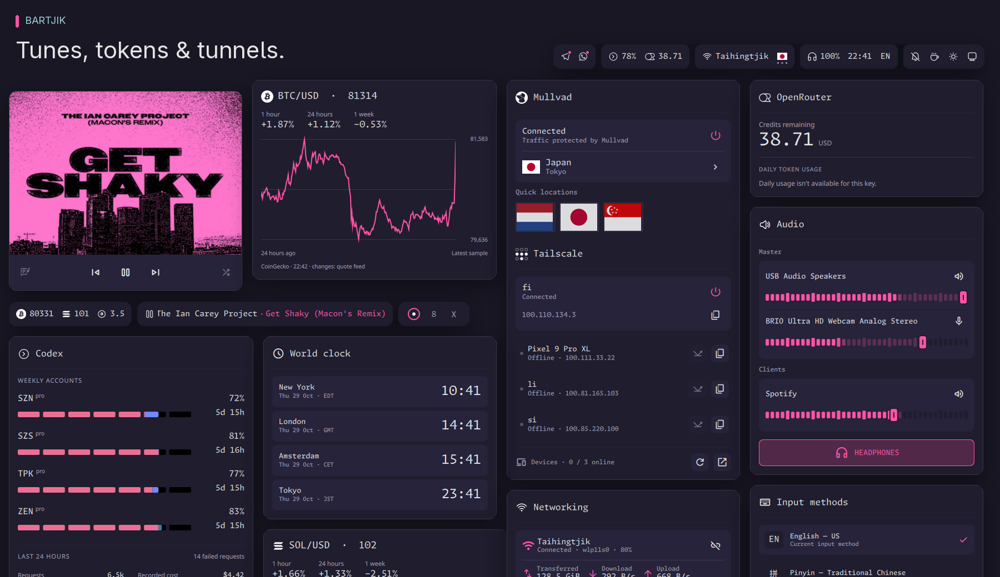
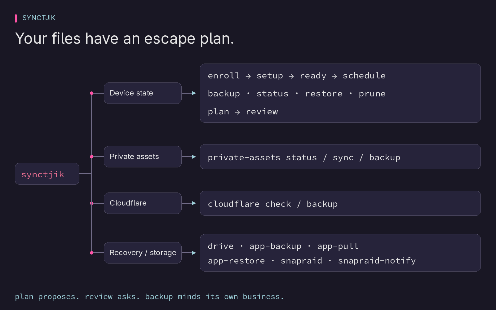
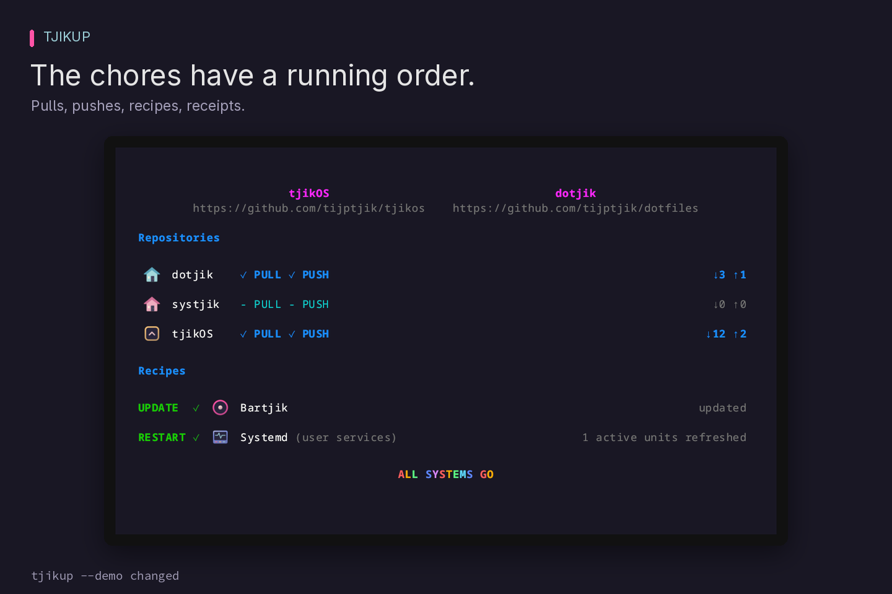
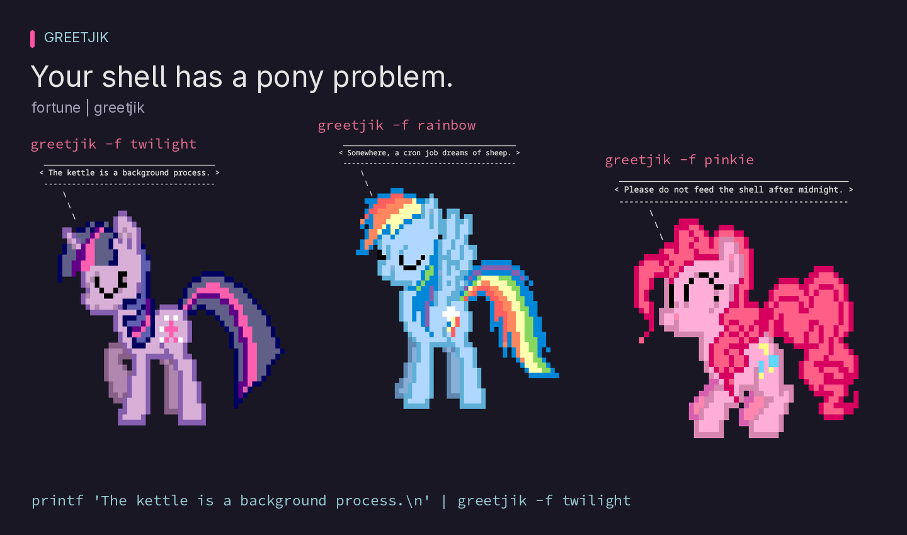

# TjikOS

Odds, ends, and mildly opinionated machinery for a Linux desktop.

  
  
  
  
  
  

<h2> Bartjik</h2>

A status bar with drawers: records, market charts, VPN routes and tailnet
neighbours. Give each monitor its own arrangement; pull a panel off the bar
when you want it to stay awhile.

[Overview](apps/bartjik/README.md) ·
[Installation](apps/bartjik/README.md#install-and-run) ·
[Configuration](apps/bartjik/README.md#configuration-and-precedence)

<h2> Notjik</h2>

Little interruptions with somewhere to go. Progress cards, timers and grouped
history keep the pile manageable; Telegram replies can happen right on the card.

[Overview](apps/notjik/README.md) ·
[Installation](apps/notjik/README.md#install-and-start) ·
[Card types and API](apps/notjik/docs/cards.md)

<h2> Runtjik</h2>

A desktop rummage drawer: launch apps, find windows, recall Fish commands and
clipboard scraps, grab screenshots, record the screen, or hunt down a word.

[Overview and controls](apps/runtjik/README.md) ·
[Memory and startup measurements](apps/runtjik/README.md#motivation-and-measurements) ·
[Configuration](apps/runtjik/README.md#configuration) ·
[Provider API and future ZenTabs](apps/runtjik/README.md#provider-api-v1-and-future-zentabs)

<h2> Synctjik</h2>

For the day a machine forgets who it is. Encrypted snapshots, guided restores
and reviewed device-state synchronization, written in Rust. Scheduled backups
keep their own timetable, independent of configuration updates.

[Overview and commands](apps/synctjik/README.md) ·
[Bootstrap](apps/tjikos-sh/README.md)

Snapshot backups and reviewed synchronization are separate commands. `plan`
prepares a change; `review` requires confirmation before applying it.

<h2> Tjikup</h2>

The pull, build, install, restart shuffle—written down once. Rust recipes run
in dependency order, share resource locks, make scoped autocommits and leave
private receipts. A notification tells you how the chores went.

[Overview](apps/tjikup/README.md) ·
[Configuration](apps/tjikup/README.md#configuration) ·
[Configuration managers](apps/tjikup/README.md#configuration-managers-and-templates)

<h2> Greetjik</h2>

577 ponies walk into a terminal. You supply the dialogue. The complete ponysay
artwork catalogue lives in one native Rust executable; pipe in a fortune,
a greeting, or whatever the kettle just told you.

[Overview and usage](apps/greetjik/README.md) ·
[Installation](apps/greetjik/README.md#build-and-install) ·
[Motivation and benchmarks](apps/greetjik/README.md#motivation)
