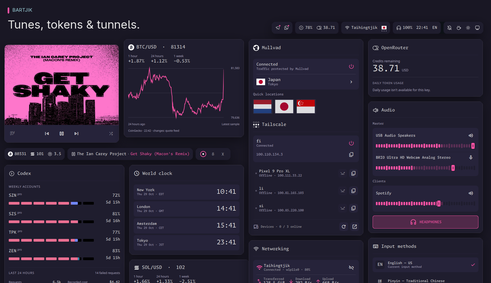
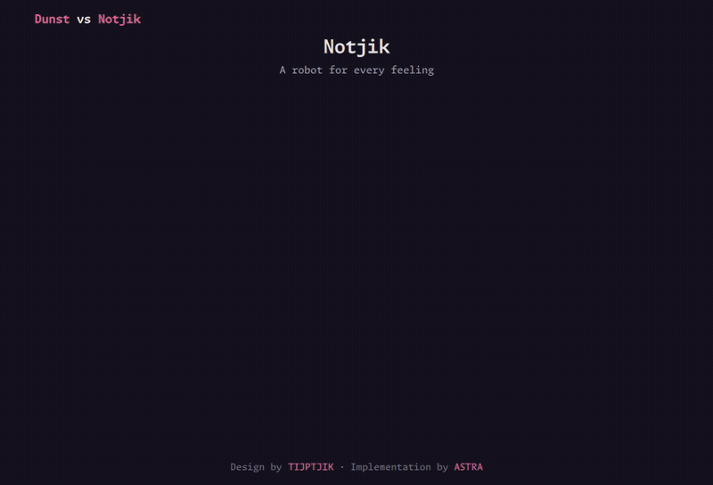
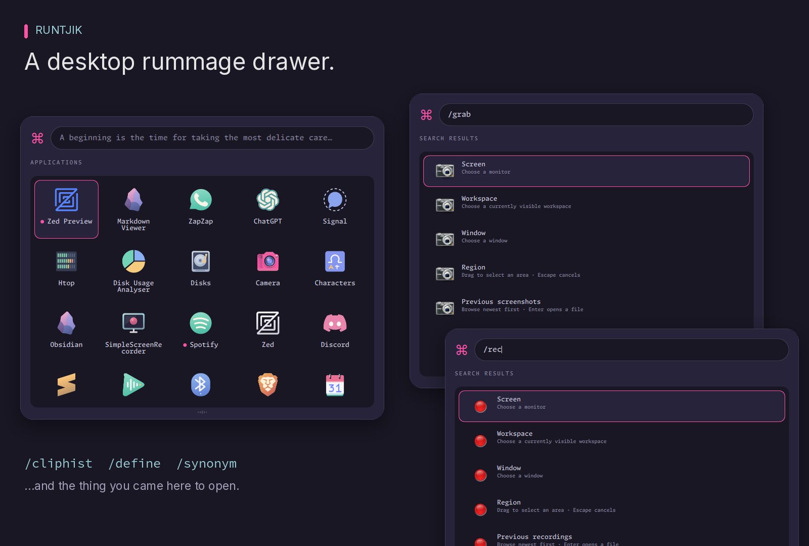
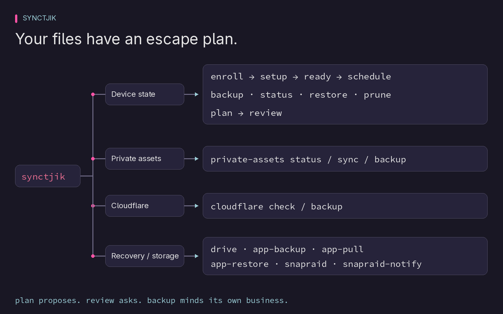
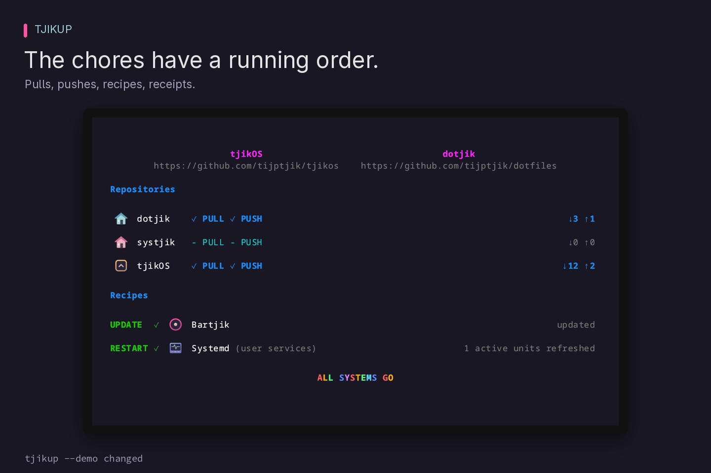
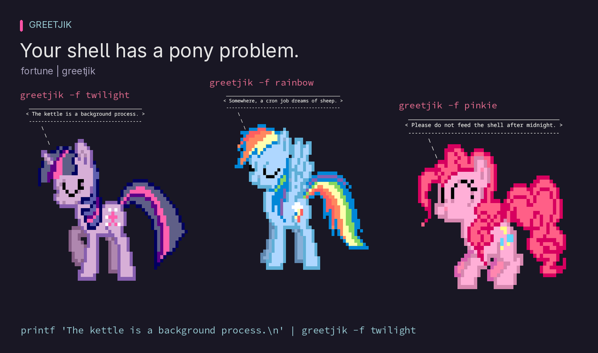

# tjikOS

Odds, ends, and mildly opinionated machinery for a Linux desktop.

<p>
  <a href="apps/bartjik/README.md"></a>
  <a href="apps/notjik/README.md"></a>
  <a href="apps/tasktjik/README.md"></a>
  <a href="apps/runtjik/README.md"></a>
  <a href="apps/synctjik/README.md"></a>
  <a href="apps/tjikup/README.md"></a>
  <a href="apps/greetjik/README.md"></a>
</p>

<h2> Bartjik</h2>



A status bar with drawers: records, market charts, VPN routes and tailnet
neighbours. Give each monitor its own arrangement; pull a panel off the bar
when you want it to stay awhile.

[Overview](apps/bartjik/README.md) ·
[Installation](apps/bartjik/README.md#install-and-run) ·
[Configuration](apps/bartjik/README.md#configuration-and-precedence)

<h2> Notjik</h2>



Little interruptions with somewhere to go. Progress cards, timers and grouped
history keep the pile manageable; Telegram replies can happen right on the card.

[Overview](apps/notjik/README.md) ·
[Installation](apps/notjik/README.md#install-and-start) ·
[Card types and API](apps/notjik/docs/cards.md)

<h2> Tasktjik</h2>

Tasks, reading lists and agent work with blockers and attributed verification evidence.
Standalone window and shared authority, also accessible from Runtjik and Notjik.

[Usage and agent API](apps/tasktjik/README.md)

<h2> Runtjik</h2>



A desktop rummage drawer: launch apps, find windows, recall Fish commands and
clipboard scraps, grab screenshots, record the screen, or hunt down a word.

[Overview and controls](apps/runtjik/README.md) ·
[Memory and startup measurements](apps/runtjik/README.md#motivation-and-measurements) ·
[Configuration](apps/runtjik/README.md#configuration) ·
[Provider API and future ZenTabs](apps/runtjik/README.md#provider-api-v1-and-future-zentabs)

<h2> Synctjik</h2>



For the day a machine forgets who it is. Encrypted snapshots, guided restores
and reviewed device-state synchronization, written in Rust. Scheduled backups
keep their own timetable, independent of configuration updates.

[Overview and commands](apps/synctjik/README.md) ·
[Bootstrap](apps/tjikos-sh/README.md)

Snapshot backups and reviewed synchronization are separate commands. `plan`
prepares a change; `review` requires confirmation before applying it.

<h2> Tjikup</h2>



The pull, build, install, restart shuffle—written down once. Rust recipes run
in dependency order, share resource locks, make scoped autocommits and leave
private receipts. A notification tells you how the chores went.

[Overview](apps/tjikup/README.md) ·
[Configuration](apps/tjikup/README.md#configuration) ·
[Configuration managers](apps/tjikup/README.md#configuration-managers-and-templates)

<h2> Greetjik</h2>



577 ponies walk into a terminal. You supply the dialogue. The complete ponysay
artwork catalogue lives in one native Rust executable; pipe in a fortune,
a greeting, or whatever the kettle just told you.

[Overview and usage](apps/greetjik/README.md) ·
[Installation](apps/greetjik/README.md#build-and-install) ·
[Motivation and benchmarks](apps/greetjik/README.md#motivation)

## Local development and installation

From this checkout, use the development runner to keep the installed application
in sync before launching it:

```sh
bun run dev runtjik
bun run dev mailtjik -- read
bun run dev greetjik -- --help
bun run dev --check runtjik
```

`dev` supports `mailtjik`, `notjik`, `tjikup`, `synctjik`, `greetjik`, `bartjik`,
`runtjik`, and `tasktjik`. It fingerprints source content (including uncommitted
and new files), workspace dependencies, shared build/install scripts, and the
installed executables and runtime files. The first invocation establishes a
receipt. Later invocations skip building and installing when both fingerprints
match. Missing or changed installed files trigger repair. `--check` only reports
freshness and exits 0 for current or 1 for an update needed.

When stale, the runner installs locked Bun dependencies, builds the selected app
and its workspace dependencies through Turbo, installs those local artifacts, and
launches `~/.local/bin/<app>`. A user-wide lock serializes development installs,
including shared dependencies. A failed command or a source edit during the
build prevents launching and leaves no successful receipt. Receipts live in
`$XDG_CACHE_HOME/tjikos/local-run` (normally `~/.cache/tjikos/local-run`). The runner
uses the current checkout; it does not pull or push Git changes.

Arguments after the app name are passed through literally; the separator `--` is
optional. With no arguments, Mailtjik opens `read`, Runtjik and Tasktjik use
`show`, and Tjikup/Synctjik show help instead of starting an update or sync.
Notjik and Bartjik reuse an active user service, restarting it after an update;
otherwise the runner replaces only that application's installed Quickshell UI.
No archive workers are stopped. Existing app configuration and data are preserved.
This is an explicit development mode; ordinary installed commands and desktop
shortcuts continue launching the installed copy directly.

For a full local installation:

```sh
bun install
bun run install:local
```

This builds and installs all eight applications, including Runtjik, Bartjik and
Tasktjik. It explicitly installs locally built Tjikup and Synctjik binaries. Their
normal standalone installers still fetch pinned releases unless `--from-build`
is supplied. To build and install only Runtjik and its dependency:

```sh
bun run build --filter=@tjikos/runtjik
bash scripts/install.sh --from-build runtjik
```

Run `bun run test:local-run` to check freshness, repair, failure handling, and
concurrent development invocations using isolated fixtures.

## WhatsApp scripting

[Whatsover](packages/whatsover-engine/README.md) provides a direct Rust WhatsApp
client with a JSON CLI. Install with
`bash packages/whatsover-engine/scripts/install.sh`, then run `whatsover login`
to scan the QR code. `bun run whatsover` runs the same client from the checkout.
Session state stays outside the repository. The former Baileys desktop service
and launcher are retired.
