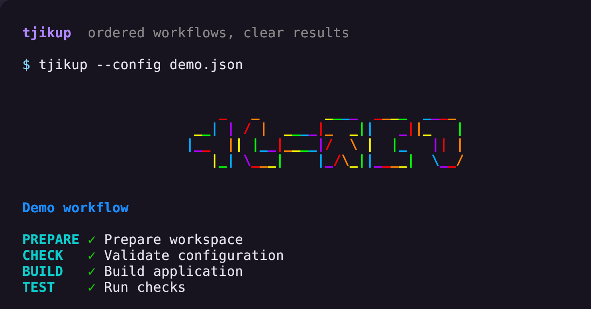

# tooltjik

Linux desktop utilities and terminal tools.

##  Notjik

Actionable desktop notifications with live progress, timers, grouped history,
and optional Telegram replies.

[Overview](apps/notjik/README.md) ·
[Installation](apps/notjik/README.md#install-and-start) ·
[Card types and API](apps/notjik/docs/cards.md)

##  mailtjik

Search and read email in the terminal, and preserve it in encrypted annual
archives.

[Overview](apps/mailtjik/README.md) ·
[Installation](apps/mailtjik/README.md#install) ·
[Setup and usage](apps/mailtjik/README.md#setup)

##  tjikup

A configurable script runner with ordered stages, parallel groups, clear status
rows, and completion notifications.

[Overview](apps/tjikup/README.md) ·
[Installation](apps/tjikup/README.md#install-and-run) ·
[Configuration](apps/tjikup/README.md#configuration-version-1)

##  bartjik

Configurable desktop bars with independent monitor layouts, interactive modules,
and live status panels.

[Overview](apps/bartjik/README.md) ·
[Installation](apps/bartjik/README.md#install-and-run) ·
[Configuration](apps/bartjik/README.md#configuration-and-precedence)

##  pony-rs

The complete ponysay artwork catalogue and piped quotes in a fast native Rust
executable, with no Python or Docker runtime.

[Overview and usage](apps/pony-rs/README.md) ·
[Installation](apps/pony-rs/README.md#build-and-install) ·
[Motivation and benchmarks](apps/pony-rs/README.md#motivation)
