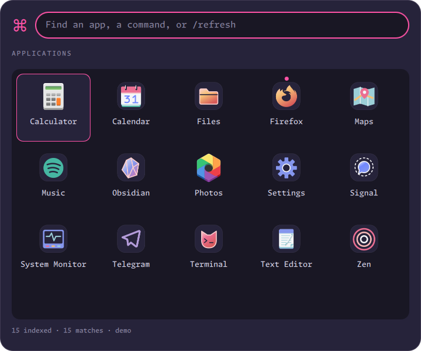
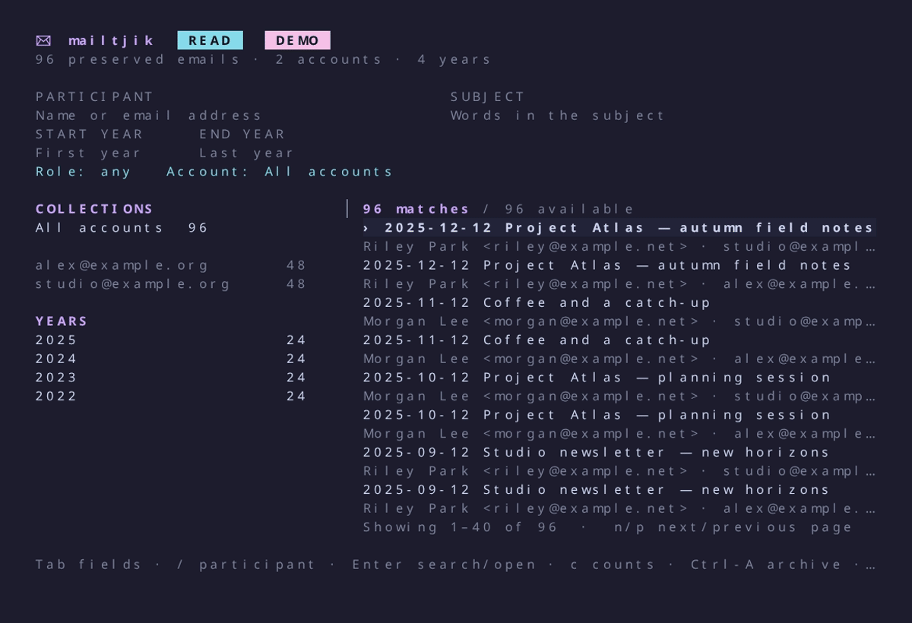

# TjikOS

Linux desktop utilities and terminal tools.

##  Runtjik

A Quickshell launcher that stays warm after first use, with an icon grid, application and
command discovery limited to Fish history, launch statistics, and keyboard window switching. Drag the
top-layer launcher and edit featured TOML settings through `/config`. Outside clicks
close it without consuming the click.

[Overview and controls](apps/runtjik/README.md) ·
[Memory and startup measurements](apps/runtjik/README.md#motivation-and-measurements) ·
[Configuration](apps/runtjik/README.md#configuration) ·
[Provider API and future ZenTabs](apps/runtjik/README.md#provider-api-v1-and-future-zentabs)

##  Notjik

Actionable desktop notifications with live progress, timers, grouped history,
and optional Telegram replies.

[Overview](apps/notjik/README.md) ·
[Installation](apps/notjik/README.md#install-and-start) ·
[Card types and API](apps/notjik/docs/cards.md)

##  mailtjik

Search and read email in the terminal, and preserve it in encrypted annual
archives.

[Overview](apps/mailtjik/README.md) ·
[Installation](apps/mailtjik/README.md#install) ·
[Setup and usage](apps/mailtjik/README.md#setup)

##  tjikup

A Rust recipe runner with dependency scheduling, shared resource locks, scoped
autocommits, private execution receipts, and completion notifications.

[Overview](apps/tjikup/README.md) ·
[Configuration](apps/tjikup/README.md#configuration) ·
[Configuration managers](apps/tjikup/README.md#configuration-managers-and-templates)

##  bartjik

Configurable desktop bars with independent monitor layouts, interactive modules,
and live status panels.

[Overview](apps/bartjik/README.md) ·
[Installation](apps/bartjik/README.md#install-and-run) ·
[Configuration](apps/bartjik/README.md#configuration-and-precedence)

##  greetjik

The complete ponysay artwork catalogue and piped quotes in a fast native Rust
executable, with no Python or Docker runtime.

[Overview and usage](apps/greetjik/README.md) ·
[Installation](apps/greetjik/README.md#build-and-install) ·
[Motivation and benchmarks](apps/greetjik/README.md#motivation)
