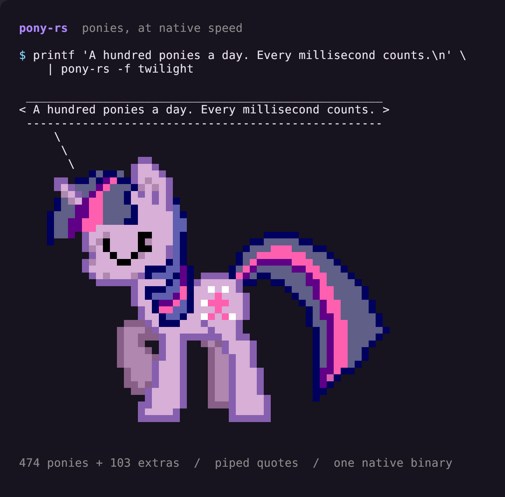

# tooltjik

A collection of Linux desktop utilities and terminal programs for notifications,
status bars, scripted workflows and mail archives.

## Notjik

**Notifications you can act on: live status, progress, timers, grouped history,
and Telegram replies, with a robot for every feeling.**


[Installation](apps/notjik/README.md#install-and-start) ·
[Card types and calling the API](apps/notjik/docs/cards.md) ·
[Configuration and full documentation](apps/notjik/README.md)

Both sides receive the same messages and artwork, including the same robot
selection. Telegram replies and voice recording are simulated in the demo;
real Telegram integration is optional.

- Receives ordinary desktop notifications through `org.freedesktop.Notifications`.
- Shows command buttons, sender artwork, live progress, status and countdown cards.
- Updates one card in place with a stable sender ID, instead of adding a new card.
- Groups conversations and keeps searchable local notification history.
- Supports Telegram text, photos, voice and animated media through an optional bridge.
- Offers robot artwork, rose-punk and monochrome themes, and configurable placement.

### Install Notjik

Requires Hyprland, Quickshell 0.3.2+, Qt Quick/Controls, Qt5Compat GraphicalEffects,
Python 3 and `busctl`. Bun builds the workspace. Qt Multimedia is needed for media;
see the [installation guide](apps/notjik/README.md#install-and-start) for session
startup, optional Telegram dependencies, and switching from another daemon.

```sh
git clone https://github.com/tijptjik/tooltjik.git
cd tooltjik
bun install
bun run --filter @tooltjik/notjik build
bash scripts/install.sh notjik
notjikctl init --theme rose-punk
# Stop your existing notification daemon/autostart before starting Notjik.
notjik
```

The installer does not stop your current notification daemon or start Notjik.
`init` preserves existing configuration. Commands install to `~/.local/bin`;
ensure that directory is on your PATH.

### Send a card

```sh
notjikctl send 'Flight recorder secured' 'Black box synced.'
notjikctl send 'Star chart transfer' --app navigation --id sector-map \
  --type progress --data '{"value":35,"label":"Receiving star charts"}' --timeout never
notjikctl send 'Star chart transfer' --app navigation --id sector-map \
  --type progress --data '{"value":80,"label":"Resolving jump coordinates"}' --timeout never
notjikctl history toggle
```

| What you need                             | Documentation                                                                                    |
| ----------------------------------------- | ------------------------------------------------------------------------------------------------ |
| Standard notifications, icons and artwork | [Standard cards](apps/notjik/docs/cards.md#standard-cards-and-artwork)                           |
| Status and errors                         | [Status cards](apps/notjik/docs/cards.md#status-and-errors)                                      |
| Progress and updates                      | [Persistent IDs](apps/notjik/docs/cards.md#update-one-card-in-place)                             |
| Timers and buttons                        | [Timers](apps/notjik/docs/cards.md#timers) · [Actions](apps/notjik/docs/cards.md#action-buttons) |
| Grouping and notification history         | [Grouping](apps/notjik/docs/cards.md#grouping-and-history)                                       |
| Telegram text, photos, voice and GIFs     | [Telegram setup](apps/notjik/README.md#telegram-photos-and-voice-messages)                       |
| Run or record the showcase                | [Demo commands](apps/notjik/README.md#directed-comparison-cycle-and-recording)                   |
| Dunst compatibility and differences       | [Comparison guide](apps/notjik/docs/comparison.md)                                               |

## mailtjik

**Preserve email in encrypted annual archives, then find and read it in the terminal.**


_Recorded with Charm VHS using synthetic mail only._

- Participant, From/To/Cc/Bcc, subject, account and year-range search.
- Account, year and search-result counts.
- Glamour Markdown rendering, HTML conversion and bounded inline Kitty images.
- Encrypted annual archives, read-only capture, label exclusions and durable workers.

## Install

```sh
bun install
bun run install:local
```

Mailtjik requires Bun, Go, Python, age, zstd and rclone; see the [mailtjik installation guide](apps/mailtjik/README.md#install). Notjik requires Quickshell, Qt Quick and Python; see the [notjik installation guide](apps/notjik/README.md#install-and-start).

## Setup

Open `mailtjik archive` → **Setup** to choose private working paths. Prepare retained sources, then publish encrypted annual collections. See [archive preparation and live account setup](apps/mailtjik/README.md#setup).

## Use

```sh
mailtjik          # choose a mode
mailtjik read     # find and read email
mailtjik archive  # prepare, capture and preserve
```

See the [full mailtjik README](apps/mailtjik/README.md) for features, key bindings, restoration and the VHS demo tape. `READMD.md` is also available with the requested spelling.

## Workspace

Applications live under `apps/`; shared libraries can live under `packages/`.
`bun run build` builds through Turbo; `bun run check` performs static checks;
`bun run demo` regenerates the synthetic-mail recording.

## tjikup

[Configurable script runner](apps/tjikup/README.md) with ordered stages, explicit
parallel groups, status rows, dry-run commands and completion notifications.
Requires only Python 3.10+. Workflows and fleet policy live in their own repos.

```sh
bash apps/tjikup/scripts/install.sh
tjikup --config /path/to/workflow.json --check
```

## bartjik

[Configurable Quickshell bars](apps/bartjik/README.md) with monitor-local islands,
16 providers, themes, live configuration and `bartjikctl` diagnostics.

```sh
bun run --filter @tooltjik/bartjik build
bash scripts/install.sh bartjik
```

Installation does not start a desktop session or replace Waybar/notjik. See the app
guide for synthetic previews and deliberate switch-over/rollback.

## pony-rs

**The complete ponysay artwork catalogue, rendered by a fast native Rust executable.**



474 regular ponies, 103 extras, and their TTY variants, with piped quotes and no
Python or Docker runtime. Measured median rendering time: **1.27 ms**, compared
with **479.20 ms** for the Docker pipeline using the same pony and quote.

```sh
fortune | pony-rs
```

[Usage and installation](apps/pony-rs/README.md) ·
[Motivation](apps/pony-rs/README.md#motivation) ·
[Reproducible benchmark](apps/pony-rs/README.md#speed-compared-with-docker)
