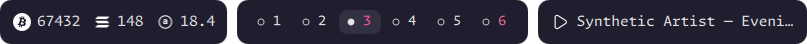
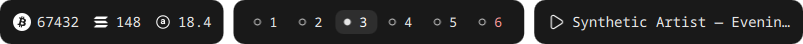

# bartjik

A configurable Quickshell bar with independent monitor layouts, transparent gaps,
rounded islands and typed, individually interactive items. `bartjikctl` controls
visibility and exposes configuration, provider data and resolved geometry.

| Rose-punk | Monochrome |
| --- | --- |
|  |  |
|  |  |

These are actual QML captures containing synthetic data only. Screenshot crops
show the rendered groups; the render test separately asserts their position within
the screen column. No desktop, account, SSID or usage records are captured.

## Install and run

Requires Quickshell **0.3.2+**, Qt 6 Quick/Controls/Effects, Python 3.11+, and a Wayland
compositor with layer-shell support. Hyprland workspace actions target the current
**Lua** configuration interface. Bun/Turborepo are build tools, not runtime services.

```sh
bun install
bun run --filter @tooltjik/bartjik build
bash scripts/install.sh bartjik
bartjikctl init --preset desktop --theme rose-punk
bartjikctl config --validate
bartjik
```

The installer does not start or enable services, overwrite configuration, or stop
Waybar/notjik. Source entry points are `apps/bartjik/bin/{bartjik,bartjikctl}`.
`bartjik --config /absolute/config.json` selects a file; set `BARTJIK_CONFIG` to
the same file for offline `bartjikctl config --validate` or `init` operations.
`bartjik --daemon` detaches; the foreground process suits the supplied user unit.

Safe synthetic preview:

```sh
cd apps/bartjik
dbus-run-session --config-file tests/bus.conf -- bin/bartjik --demo --config examples/demo.json
```

### Waybar comparison recording

The directed demo recreates the current Waybar island layout on the left and
the matching Bartjik island on the right, using a temporary 1000×680 headless
output and bundled synthetic data. It shows one island group at a time and moves
matching hover targets on both sides. The private Waybar copy has no
click or scroll handlers: each hover shows a tooltip only. Bartjik retains its
native hover behavior. The finale moves one attached panel from Bitcoin to the
player to workspaces, then detaches BTC and SOL graph panels as widgets.

```sh
cd apps/bartjik
bun run demo:cycle -- --plan
bun run demo:record -- /tmp/bartjik-waybar-comparison.mp4
```

`demo:record` never overwrites a video or chapters manifest. It records lossless
RGB first, encodes a playable H.264 MP4, and writes a matching `.chapters.json`.
It runs a private nested Hyprland instance with its own headless capture output,
runtime directory, configuration and input. It does not start, stop, or
read data from the running Waybar/Bartjik services or real providers.

The stage follows the Notjik comparison: title and explanatory caption above
two centered lanes, an animated overview, then one island group at a time.
Each hover holds for three seconds after a smooth pointer move. `--speed` is
a playback rate, defaulting to **1.4** (40% faster), so the resulting holds are
about 2.14 seconds. Panel tracking receives frame-paced synthetic pointer updates;
detachment uses the actual panel origin. The private compositor disables native
window borders. The private Waybar configuration derives
from `~/.config/waybar/config`, `style.css`, and `colors.css`. Custom module IDs
and the AI group retain their original styling. Native data modules use static
synthetic replacements with corresponding CSS selectors. The tray uses the real
Waybar SNI module on a private D-Bus session with synthetic Telegram, WhatsApp and
VLC items and their installed legacy application icons, rather than Bartjik artwork.
This is real Waybar with fixture data, not an unmodified live desktop capture.
Waybar retains its natural height; Bartjik retains its taller configured height.
Both are centered vertically and the intro preserves their natural sizes.
The player fixture shows Karla Blum - Acid Rain as playing (no audio is recorded),
and workspaces stop at X. All external callbacks are removed, and all Waybar hovers use native
GTK tooltips. The original configuration and services are not modified.

Recording requires Hyprland, GTK 3 and Wayland development packages, a C compiler,
`wayland-scanner`, `grim`, `wf-recorder`, FFmpeg, Waybar and Quickshell with
QtTest, plus `dbus-daemon`, Python D-Bus and PyGObject. A private GTK helper reports actual widget bounds, and an output-bound
Wayland pointer drives Waybar while QtTest drives matching Bartjik targets.
Pointer checks compensate for seat warps caused by Qt popup mapping, and a
brief transition mask reveals the two islands only after both renderers settle.
The recorder checks output dimensions and native tooltip visibility, and keeps
diagnostic screenshots and logs in its printed `/tmp/bartjik-cycle-*` directory.
The chapters manifest includes hover checks and hashes of the Waybar source
configuration. Keep recordings and captures outside the repository.

Demo does not start polling processes, native tray/MPRIS subscriptions, or actions.
For simultaneous development instances copy `qml/` to a temporary directory and
set `BARTJIK_QML` to it for both launcher and CLI. Quickshell identifies instances
by QML path, independently of their JSON configuration path. Its IPC sockets/logs
use `$XDG_RUNTIME_DIR/quickshell`; no separate writable state database is needed.
Configuration lives at `$XDG_CONFIG_HOME/bartjik/config.json`.

## Switch-over and rollback

Build and test independently before changing the desktop session. Review
`bartjikctl config --validate`, confirm connector names with `bartjikctl monitors`,
and edit the presets for your displays. Desktop defaults use DP-1/DP-2; laptop
uses eDP-1. Both presets contain all 16 providers. More than one bar in a section
stacks inward. Services unavailable on a host report an unavailable state.

For a deliberate switch, stop the existing Waybar service/autostart process using
its existing session controller, then start `bartjik` in a terminal. Keep that
terminal available during acceptance. Verify workspace ownership, audio route
selection and panels interactively before enabling `bartjik.service`. Ensure the
user service environment includes `WAYLAND_DISPLAY`, `HYPRLAND_INSTANCE_SIGNATURE`,
`DBUS_SESSION_BUS_ADDRESS` and the desired API environment variables. The unit
starts neither notjik nor the external panels.

Rollback: stop bartjik (Ctrl-C or `systemctl --user stop bartjik.service`), disable
its autostart if enabled, and start the original Waybar service/autostart entry.
The build does not edit Waybar, monitor configuration, notjik or their startup
entries. Do not run two production tray hosts for acceptance; the provided tests
use a separate bus and never take the desktop notification name.

## Control and diagnostics

```sh
bartjikctl status                 # helper/config/action errors, ready state
bartjikctl monitors               # connector, logical width/height, scale
bartjikctl config                 # running last-valid effective global config
bartjikctl config --validate      # validate the file without a running bar
bartjikctl bars                   # resolved geometry, clipping, island rectangles
bartjikctl modules                # normalized items, source keys, polls/errors
bartjikctl reload
bartjikctl hide workspace-bar
bartjikctl show all
bartjikctl toggle status-bar
```

`modules` may include private provider tooltips. Use it locally; do not paste its
full output into public logs. `status` contains no provider payloads. CLI failures
have nonzero status and structured error output. Actions report asynchronous
failures through `status.actionError`; they never optimistically change VPN state.
Visibility overrides are shared by named bar across screens and last until restart.

JSON, named-theme files, provider settings, action bindings, style and layout all
reload within about one second. Invalid edits retain the last valid state and
subscriptions. Impossible centre widths are rejected against connected screens;
an invalid hotplug layout retains the prior valid model until corrected. QML,
Python source, environment credentials and process-level Qt settings require a
restart. A helper restart reconnects providers; it does not replay actions.

## Configuration and precedence

See [`examples/desktop.json`](examples/desktop.json),
[`examples/laptop.json`](examples/laptop.json) and the smaller
[`examples/minimal.json`](examples/minimal.json). IDs must be unique within their
bar/module/island scopes. `modules` is a named registry; islands reference its keys.
When supplied, the top-level module registry replaces the minimal default registry.

Objects merge recursively. **Every array replaces**, including bars, islands,
module order, assets, routes and monitor selectors. There is no index-based array
merge. Precedence is defaults → selected theme → global configuration → numeric
per-monitor override → connector override → bar configuration → bar's numeric and
connector override. Module settings additionally merge bar `modules` over the
monitor's module registry. Part styling/actions additionally apply item-ID patches.
Global `perMonitor` supports `enabled`, `layout`, `theme`, `style`, and `modules`.
Bar `perMonitor` supports bar settings, `style`, `modules` and replacement islands.
Use global `perMonitor.theme` for monitor-specific named themes.

```json
{
  "theme": "rose-punk",
  "layout": {"centre_width": "40%", "sides": {"l": {"centre_width": "50%"}}},
  "perMonitor": {"DP-2": {"layout": {"centre_width": "640px"}}},
  "modules": {"time": {"provider": "datetime"}},
  "bars": [{
    "id": "clock", "monitors": ["DP-1", "DP-2"],
    "side": "b", "position": "l", "alignment": "r",
    "offsetX": 0, "offsetY": -20,
    "islands": [{"id": "clock", "modules": ["time"]}]
  }]
}
```

Monitor selectors accept `"all"`, 1-based indexes or connector names. Indexes refer
to `bartjikctl monitors` order; prefer connector names in saved configurations.
Unlike notjik's `placement.edge`, bartjik names the edge `side` and places layout
options on each bar. Offsets have the same physical-pixel/sign convention.

### Geometry

For top/bottom bars the screen span is logical width `W`. Omitted `centre_width`
is **exactly W/3**. Numeric values and `"640px"` are physical pixels, divided by
that screen's scale. Percentages use that screen's full span. Resolve `C`, then
`L=(W-C)/2`; the columns are `[0,L)`, `[L,L+C)`, `[L+C,W)`.

`position` chooses a column; `alignment` places the content inside that column,
after logical `padding` at both ends. Column boundaries never depend on another
bar's content. For `W=1920`, default `C=640`, content width 400, `b/l/r` starts at
**240** and ends at **640**. With `C="960px"`, scale 1, it starts at **80**.

On left/right sides the same model uses screen **height**. `position`/`alignment`
`l`, `c`, `r` mean top/start, centre, bottom/end. `centre_width` remains the key
name but describes the vertical centre span. Islands/modules/items stack vertically;
text stays upright. `verticalWidth` bounds the cross-axis width and its text elision.

Column definitions exist only in global/perMonitor `layout` and its `sides` map.
Individual bar definitions containing `layout` or `centre_width` are rejected.
Bars sharing a screen/side/section stack inward in configuration order, using
`thickness` (horizontal) or `verticalWidth` (vertical) plus `stackGap`. Set those
cross-axis sizes large enough for custom content; larger visual contents can overlap
another stack unless the sizes are increased. Offsets then apply: positive X right,
positive Y down. Numeric/px offsets are physical pixels; percentages use the full
screen's corresponding width or height. Offscreen offsets are intentionally clipped
by the screen, not clamped back to a different column.

Overflow defaults to `"clip"`. Opt-in `overflow:"centre"` lets a side section
borrow up to half the central column, expanding inward from its outer edge when
content exceeds the normal column width. Its outer edge stays on screen before
explicit offsets. Left and right overflow have disjoint halves; a separately
configured central bar may overlap them. Oversized content still clips at this
limit. This works on vertical sides too. Normal-sized content retains the selected
position/alignment and stable column boundaries. Text elides at `maxTextWidth`.
Font, padding, icon sizes, gaps and thickness are **logical UI pixels**.

### Surfaces, visibility and style

Each island has one background/border/radius/padding. `iconTextGap`, `itemGap`,
`moduleGap` and bar `islandGap` are distinct. Theme tokens include `font`,
`iconFont`, `fontSize`, `iconSize`, `background`, `surface`, `border`, `text`,
`muted`, `accent`, `radius`, `padding`, `paddingX`, `paddingY`, `borderWidth`, `minItemSize`, `maxTextWidth`.
Per-part `style` can override font/size/color. State styles include active, focused,
urgent, muted, disconnected, stale and hover. Qt falls back to installed fonts if
`tijpset` or a glyph is unavailable. Material Symbols Rounded is used only by
`kind: "symbol"`; normal text does not use ligature icons.

`layer` is background/bottom/top/overlay. Default overlay behavior is `reserve:false`;
`reserve:true` creates **one reservation per screen/edge** using the largest requested
depth, never a reservation per bar. Layer-shell reservation necessarily spans an
edge; it is opt-in. Rounded input masks cover visible islands only, so transparent
gaps and the rest of the full-screen transparent surfaces pass desktop clicks.
`visible:false` starts hidden. `autoHide:true` enables edge activation. All these
bar settings live-reload, including per-monitor overrides:

| Setting | Default | Meaning |
| --- | --- | --- |
| `activationEdge` | `"side"` | `t/r/b/l`, or follow the bar side. The entire edge of this bar's monitor activates it. |
| `syncMonitors` | `true` | Reveal and hide all participating auto-hide bars together across monitors, including bars limited to one screen. Set to `false` for independent activation; a per-monitor override excludes that copy from synchronization. |
| `activationDelay` | `0` | Milliseconds of continuous edge contact before showing; leaving cancels it. |
| `revealSize` | `3` | Physical-pixel tolerance for touching the activation edge (minimum one logical pixel). |
| `keepVisibleDistance` | `"64px"` | Inward distance from the activation edge that keeps an already visible bar open. Physical pixels (number or `px`) or percentage of screen height for top/bottom, width for left/right. It never activates a hidden bar. |
| `hideDelay` | `0` | Milliseconds continuously outside the safe distance and bar before hiding. Reentry cancels it. |
| `fadeDuration` | `180` | Milliseconds per opacity transition; `0` disables animation. Reverses smoothly on reentry. |

With `syncMonitors:true`, touching any participating bar's activation edge reveals
all participating bars, including a status bar configured only on the main screen.
Hovering any member, keeping its native tray menu or panel open, or staying within
its safe distance keeps the group visible. Geometry, edge and delay settings come
from the bar receiving the input; after leaving the group, the last source bar's
hide delay applies. Moving to another activation source restarts
pending activation dwell. Disabled, CLI-hidden and non-auto-hiding copies do not
participate. For independent screens, add `"syncMonitors": false` to the relevant
object in `bars`.

Hovering the bar or keeping its native tray menu open also prevents hiding.
A shared Hyprland command-socket observer samples at 50ms, independently of
Waybar and without spawning polling processes. Detection has up to one sample
of latency plus frame scheduling; `0` means no additional intentional delay.
Monitor geometry refreshes every second, including scale/rotation/hotplug. The
safety zone and activation edge never intercept desktop clicks; only fading or
visible islands have input regions. If the observer fails, bars stay visible and
`status.pointerError` reports the failure. Auto-hide requires Hyprland; other
compositors retain visible bars. The observer stops when no bar needs it.

`examples/comparison.json` is the desktop preset with `offsetY:-60`,
`activationDelay:500`, `hideDelay:1000`, `keepVisibleDistance:"140px"` and
`fadeDuration:180`. The 140px distance bridges the offset and bar height.
The single row's lower edge is 60 physical pixels above the screen bottom.
The central span is 50%, side overflow is inward, and the row is 28 logical pixels high. Launch it beside Waybar using
`bin/bartjik --config examples/comparison.json --daemon`. Touch the bottom edge
for half a second to reveal, then move upward to the bars. All bars on the same
activation edge reveal together, including their copies on other monitors by
default. CLI hide disables the surface entirely;
CLI show restores its configured auto-hide behavior.

## Providers and actions

| Provider | Data/dependency | Default actions and settings |
| --- | --- | --- |
| workspaces | One Hyprland event socket plus bounded JSON snapshot/reconnect; monitor-local views | Click absolute workspace; scroll previous/next within that screen. `special`, `scrollSpecial`, `persistent` map. |
| playerctl | Native Quickshell MPRIS, dynamic discovery | Click play/pause; scroll previous/next. `players` matches identity/desktop entry/bus suffix. Explicit preset right-click `player.quit` uses MPRIS Quit when supported. No matching player emits an empty array; empty islands disappear, including their spacing/input area. |
| crypto | CoinMarketCap HTTP; BTC/SOL/AR defaults | Independent `SYMBOL/CURRENCY` IDs; asset icon/precision/display options, interval 600s. Example BTC icon opens CMC and text opens TradingView. |
| icontray | Native SystemTray and DBusMenu | Activate, secondary activate, menu, scroll ±120; excludes Input Method. Native object lifetime IDs distinguish two instances with identical application IDs. See the documented unnamed-service limitation. |
| network | NetworkManager `nmcli`; optional `interface` | SSID/signal/wired/offline; telemetry failure preserves connected state. Click `network.panel`. |
| mullvad | `mullvad status`, never account credentials | Location tooltip; left-click connects using the saved Mullvad location, middle-click disconnects Mullvad, right-click toggles Tailscale. |
| tailscale | `tailscale status --json` | Running/stopped/needs-login/unavailable; click toggle; failed command reported. Configurable `symbol`, default vpn_lock. |
| audio | Pulse-compatible `pactl` on PipeWire/PulseAudio | **Icon switches routes; text opens panel**. Scroll ±4, middle mute; exactly `-%` when muted. Optional `routes` names/descriptions; otherwise cycles discovered sinks and moves active streams. |
| datetime | GNU `date` | `%H:%M`, alternate `%a %d %b`, full date tooltip; `timezone`, `locale`, `format`, `alternate`, `tooltipFormat`, `interval`. Click toggles each rendered clock. |
| locale | `fcitx5-remote`, active group profile | EN/拼/速 and other known methods; observes external changes; click cycles actual selected group; right opens configtool. Desktop preset places it after time. |
| codex | Read-only codex-lb SQLite, optional API | Weekly-only, capacity weighted; duration 10080 is authoritative regardless of primary/secondary. `source:"api"` uses local accounts API, or `database` overrides path. No five-hour display. |
| openrouter | Credits/key/activity HTTP endpoints | Remaining balance and daily usage hover panel; exported OPENROUTER_API_KEY. |
| DND | `notjikctl status/toggle` | Paused versus unavailable; click changes actual notjik. Never creates a NotificationServer. Optional `ctl` path. |
| caffeine | Effective `hypridle` process state | Click stops/starts hypridle as existing policy. Preset middle-click explicitly suspends. |
| nightlight | `hyprsunset` process state | Click toggles. Poweroff is **not enabled by default**; see optional example below. |
| monitor-layout | Structured `hyprctl monitors all`; existing monitor-game-mode command | Status and toggle through the existing persisted Lua mode/reload path. Keeps desktop outputs and adds TV; optional `tv`, `commandPath`. |

The destructive optional binding is explicitly shown in
[`examples/optional-poweroff.json`](examples/optional-poweroff.json):
`"middleClick": ["systemctl", "poweroff"]`. Automated tests mock it and suspension;
they never execute either command. Existing `monitor-game-mode`/`monitor-desktop-mode`
and the Lua monitor file remain an external, documented integration boundary.

Workspace data uses actual compositor ownership, not source assignment rules.
Numeric names sort numerically, then named workspaces case-insensitively, then
special workspaces. Empty placeholders are configurable per screen, never marked
active, and suppressed wherever that workspace exists on another output. Active
on this output, globally focused, and urgent are separate state fields. Event bursts
are debounced; subscription starts before the snapshot, reconnect refreshes everything,
and a 10-second reconciliation handles missed events. Action dispatch first focuses
the originating monitor and then selects an absolute numeric/name/special target.
Scroll uses that monitor's current active workspace, not the clicked item's index.

### Credential sources and caching

Export `COINMARKETCAP_API_KEY` and `OPENROUTER_API_KEY` to bartjik's environment.
The old crypto wrapper also consulted Fish's environment; launch from a session
that exports the variables or import the selected variables into the user service
manager. No credential is embedded in presets or returned in configuration.
An optional crypto `legacyConfig` path can read an existing INI (including its
asset definitions); environment credentials take precedence. This is an explicit
migration option, not a dependency on `~/.config/waybar`. Keep that private file
outside this repository and remove the option after migration.

Providers retain last useful values in memory. Failed polls become stale with
an error tooltip, initial failures become unavailable, and successful refresh clears
the error. HTTP requests have an 8-second timeout and 1 MiB bound; command output
is bounded, default 256 KiB. HTTP 429 honors numeric Retry-After (bounded to one
hour), other failures use exponential backoff. No balances/account tooltips are
persisted to disk. In-flight bounded HTTP threads may finish after config removal;
their cancelled subscribers cannot publish results or restart a polling loop.

### Native network and audio panels

Network and audio use Bartjik's shared `DetailPanel`, alongside the clock, VPN,
media and usage panels. They follow the pointer across the full icon/text/padding
hover region, stay centred on it, clamp to the current monitor and open on the
inward side of top, bottom, left or right bars. The source island, panel and 8px
travel corridor remain reachable before dismissal. Hover defaults to 300ms and
closing to 250ms, configurable with module `panel.delay` and `panel.closeDelay`
(the closing delay has a 250ms minimum for crossing between islands).
Set `panel.hover:false` to disable hover, or `panel.hover:true` to enable it.
Existing `actions.hoverEnter: "network.panel"` / `"audio.panel"` bindings also work.
Clicking opens and pins the panel. Drag the header, labels, chart or other
non-control areas to place the card on any monitor. A close button appears only
after dropping it; hovering bar items no longer replaces or repositions that card.
A click without movement leaves it attached. Closing resets it for next time.
Once dropped, drag the same areas to move the panel again. Buttons, sliders,
text fields and scrollbars retain their normal behavior; wheel scrolling still works.
Artwork, lyrics and workspace previews can also be dragged directly from their
content as soon as they open. Playback controls, middle-click playback and lyric
wheel/scrollbar controls keep their normal behavior.
With the managed Hyprland `helpers.panel_aware_drag` binding, **Super + left-drag**
also detaches an attached card from anywhere, including over controls. The shared
panel shell publishes its rounded input bounds in `$XDG_RUNTIME_DIR/bartjik-panel-PID.rect`;
the helper checks the matching live layer before passing the press to Qt. This prevents
the compositor from dragging a window underneath the panel. Normal window dragging
still uses Hyprland's native dispatcher.

After release, every detached card becomes a normal floating Hyprland window.
It stays on its workspace and supports the usual focus, move-to-workspace,
move-to-monitor and close shortcuts. New bar panels do not replace it.
The initial drag uses a layer preview until the native window has rendered;
subsequent drags use compositor window movement. On
Hyprland, disable compositor animations for those surfaces so mapping them
does not add another fade:

```lua
hl.layer_rule({ name = "bartjik-panel-immediate", no_anim = true,
    match = { namespace = "^bartjik-panel$" } })
```

Keep native detached windows floating from their first map, without compositor
blur during the transparent placement frame. Blurring those temporary window
bounds can briefly blur a large part of the destination monitor on drop.

```lua
hl.window_rule({ name = "bartjik-detached", float = true, border_size = 0,
    no_anim = true, no_blur = true,
    match = { initial_title = "^bartjik-detached:.*$" } })
```

Detached cards remain visible when their source bar auto-hides; removing their
source bar from configuration closes them. One detached card per shared panel
(crypto, detail and workspace) is supported at a time. Audio's icon
retains its separate output-route action, while its volume label opens the mixer.

The built-in audio panel keeps master output, BRIO microphone, playback client
sliders/mutes, output routing and live levels. Meter capture runs only while the
mixer is visible. Networking keeps Wi-Fi scan/radio/connect/disconnect, Ethernet,
address/DNS details and transfer statistics. Credentials still travel through
stdin. Network status and traffic are read only while the panel is open; explicit
connection operations finish even if the panel closes.
Both panels have matching title icons. The nearby Wi-Fi list shows up to three
networks at a time; scroll within the list to reach the rest.

These bar actions no longer launch the standalone Waybar widgets or use their
`panelPath`, pointer observer or positioning IPC. Their controls and helpers ship
with Bartjik; theme, monitor selection, popup lifetime and hover tracking belong
to the shared container. The standalone widgets remain available to Waybar.
Tray menus retain native DBusMenu popups anchored to their item and screen.

Synthetic acceptance (no real network/audio mutations):

```sh
dbus-run-session --config-file tests/bus.conf -- python3 -B tests/hover.py --connectivity-only
dbus-run-session --config-file tests/bus.conf -- python3 -B tests/panel_crossing.py /tmp/bartjik-panel-crossing
dbus-run-session --config-file tests/bus.conf -- python3 -B tests/native_panels.py /tmp/bartjik-native-panels
dbus-run-session --config-file tests/bus.conf -- python3 -B tests/panel_resize.py /tmp/bartjik-panel-resize
dbus-run-session --config-file tests/bus.conf -- python3 -B tests/detach.py /tmp/bartjik-detach
dbus-run-session --config-file tests/bus.conf -- python3 -B tests/reposition.py /tmp/bartjik-reposition
# Hyprland compositor opacity and surface-continuity check:
dbus-run-session --config-file tests/bus.conf -- python3 -B tests/drag_frames.py /tmp/bartjik-drag-frames
```

The fixtures exercise real Qt mouse events, icon/value/padding hover, moving
anchors, dwell cancellation, monitor changes, all four bar sides, gap traversal,
dismissal, pinning and control clicks. Demo mode uses synthetic network/audio
state and never starts traffic or meter helpers. The resize fixture samples 24
expand/shrink and panel-handoff cases, including a scrolled list that becomes shorter.

## Extending modules

Python providers live in `bartjik_core/providers.py:REGISTRY`; native services live
in `qml/Native.qml`. Renderers consume the same item contract:

```json
{"id":"BTC/USD","type":"icon_text",
 "icon":{"kind":"glyph","value":"₿","style":{},"actions":{}},
 "text":{"value":"67432","style":{},"actions":{}},
 "state":{"stale":false},"tooltip":"BTC/USD","visible":true,"enabled":true}
```

Types are icon/text/icon_text. Icon kinds: glyph, symbol (Material ligature), theme,
image (absolute file path or file URL), native (Quickshell tray image). All Text uses
`Text.PlainText`; untrusted SSIDs/metadata never become markup. Arrays need unique,
stable string IDs. Models reconcile by ID with moves/inserts/removals, retaining
part objects during updates and reordering. A removed native object closes its own
lifecycle; an ID is not reused for a new tray process.

Supported events: leftClick (`click` alias), rightClick, middleClick, doubleClick,
hoverEnter, hoverLeave, scrollUp, scrollDown. With a double binding, single-left is
delayed by `doubleClickInterval` (default Qt system setting), and double cancels it.
Without a double binding, left-click runs immediately. `hoverDelay` defaults to
250 ms; leave cancels a pending enter and fires once only after enter has fired.

Action precedence: provider item → provider part → module actions → module part →
module `items[stableID]` actions → that item's part actions. `null` disables a binding.
Commands are argument arrays, never shell-interpolated. For GUI lifetime use
`{"command":["fcitx5-configtool"],"detach":true}`. Ordinary commands are bounded
(default 15 seconds); `actionTimeout` can override this. Detached GUI startup can
report executable-launch failure but not later application failure. Command context
is JSON in `BARTJIK_CONTEXT`: bar, barKey, monitor connector, module, item, part, event,
and monitor-local logical anchor `{x,y,width,height}`. Metadata is never substituted
into argv or Lua; workspace identifiers use explicit Lua-string escaping.

All internal action names are listed in `bartjik_core/config.py:INTERNAL`. Providers
are deduplicated by normalized provider configuration, excluding visual/action
settings. One compositor subscription supplies all workspace views; MPRIS and tray
are singleton services. No poll is added when an existing module is displayed again.

A custom executable can provide typed JSON without installing Python code:

```json
{"modules":{"load":{"provider":"process",
 "command":["/absolute/path/my-load-provider"],"mode":"poll","interval":5,
 "timeout":3,"maxOutput":16384,
 "text":{"actions":{"leftClick":["my-monitor"]}}}},
 "bars":[{"id":"load","islands":[{"id":"load","modules":["load"]}]}]}
```

`mode:"stream"` reads one JSON array per line, with `timeout` as heartbeat deadline;
EOF/malformed output restarts with backoff. Commands and descendant process groups
are terminated on cancellation/reload. Process-output actions are stripped: actions
must come from trusted configuration/native code. Legacy `{text,class,tooltip}`
output is normalized with markup stripped and entities decoded. New providers should
emit typed parts rather than combined glyph/text strings.

## Validation

```sh
bun run --filter @tooltjik/bartjik check
bun run --filter @tooltjik/bartjik test
bun run --filter @tooltjik/bartjik build
cd apps/bartjik
dbus-run-session --config-file tests/bus.conf -- python3 -B tests/render.py /tmp/bartjik-previews
dbus-run-session --config-file tests/bus.conf -- python3 -B tests/native.py
dbus-run-session --config-file tests/bus.conf -- python3 -B tests/interaction.py
python3 -B tests/live_readonly.py  # opt-in; performs read-only API/service queries
```

The native fixture additionally requires `/usr/bin/python3` with dbus-python and
PyGObject. Mouse tests use QtTest; render/native tests require the active Wayland
session. See [verification evidence and limitations](docs/verification.md) and
[source inventory](docs/inventory.md). Static checks are not a claim of interactive
desktop switch-over acceptance.


### Edge activation acceptance

`dbus-run-session --config-file tests/bus.conf -- python3 -B tests/edge.py`
starts a temporary Wayland fixture with injected pointer samples. It verifies
500ms dwell/cancellation, foreign-monitor isolation, traversal to the 300px-offset
bar, 1000ms hide delay, intermediate fade opacity/reversal, empty hidden input
regions, zero-delay behavior, cross-monitor synchronization, opt-out, CLI visibility
and live reload. It requires at least two screens and never moves the desktop pointer
or invokes provider actions. Unit tests cover all four edges, scaled pixels,
percentages, negative monitor origins, rotated monitors, failure/reconnect and
one observer across multiple bars with reload cleanup. The live comparison was
started with read-only pointer tracking and unchanged Waybar tray ownership;
automated edge gestures used the isolated fixture.


### Compact comparison and crypto panel

The comparison preset places markets, music, then workspaces from left to right. Tray,
connectivity, audio/clock/input, AI balances and controls form one right-hand row.
Rows are 44 logical pixels high with `paddingX:12`, `paddingY:10`; themes default to `borderWidth:0`. Icon boxes are 18
logical pixels, independent of font metrics and native image dimensions. Tray
artwork uses `greyscaleIcons:true`, `monochromeIcon:false` at 18px. ChatGPT, Telegram
and WhatsApp use custom 1.5px outline icons to match the quieter system controls. Default UI icons
use ProIcons where available, with Material Symbols Rounded as fallback (`style.iconSet`
is `"proicons"` or `"material"`); crypto uses the circular Simple Icons Bitcoin logo and Web3 Icons mono (SOL/AR), and
Codex/OpenRouter use simplified matching outline icons. Bundled artwork and licenses live in `qml/icons/`.
Mullvad uses its connected country flag (`regionFlag:true`); disable it for a shield.
OpenRouter omits the dollar prefix by default (`currencySymbol:""`).
Controls override active-state coloring in this preset; glyph changes still show
DND/caffeine state. Font size, icon size and both padding axes remain configurable.

Workspace `occupiedOnly:true` lists workspaces with windows plus the monitor's
current workspace, including a current empty workspace. It ignores empty persistent
placeholders. `special:false` hides special workspaces; `label:"circles"` replaces
names with open circles, filling only the globally focused workspace. `label:"circles_name"` (comparison default) shows each circle followed by its
number/name once; `label:"name"` retains names without circles. Tooltip and click target always use the real workspace identifier.

`crypto.panel` is a registered part/module action. In the comparison preset,
hover anywhere in its island for 300ms to open its panel, centred horizontally on
the mouse (vertically for a side bar) and clamped to the monitor. The header includes
the selected coin logo. Padding and inter-item gaps select the nearest item; once
open, moving between coins updates immediately. Configure `panel:{"hover":true,"delay":300,"closeDelay":250}`
on the crypto module. Leaving before the delay cancels it; moving into the popup keeps
it reachable. Clicking pins it. Drag anywhere on the crypto card to place it independently;
the attached card has no drag icon, and a × close button appears after detaching. Hovering or clicking a coin again opens
another panel while detached cards keep their own selection and chart. Each detached
card closes independently. Detached crypto cards are normal floating Hyprland
windows: drag their body to move them, use normal workspace shortcuts, or close
them through the window manager. Drop coordinates are applied only once; later
window moves and workspace changes remain under Hyprland control. The attached popup prevents its parent
bar from auto-hiding; a detached card does not. It replaces crypto tooltips. It shows a public CoinGecko 24-hour
price history, and 1h/24h/7d percentage changes from the existing CoinMarketCap quote
feed. Prices and history can have different update times; the chart source and fetch
time are shown. Missing changes display an em dash, never an invented zero.

History is fetched on demand with an 8-second HTTP timeout and 1MiB response bound.
Requests deduplicate by coin/currency, cache for one minute, and back off on errors
or HTTP429 while retaining the last successful chart. There is no background history
polling. Default chart IDs are bitcoin, solana and arweave; custom assets can specify
`chartId` using CoinGecko's ID. No new credentials are needed. Closing the application
cancels pending async tasks (bounded HTTP threads can finish within their timeout).

`tests/refined.py` captures both themes and all three chart selections on Wayland;
`tests/native.py` checks MPRIS appearance/disappearance with actual empty-island
geometry. Public live chart retrieval was verified for BTC, SOL and AR. The
screenshots remain synthetic and contain no personal balances or usage records.


### Workspace hover previews

Set the workspace module's `preview` object (enabled in the comparison preset):

```json
"preview": {
  "enabled": true,
  "delay": 300,
  "slideDuration": 120,
  "closeDelay": 250,
  "refreshInterval": 50,
  "maxWindows": 12
}
```

All values except `enabled` are numbers; delays/intervals are milliseconds and
the width follows the monitor aspect ratio at the shared card height. Crypto and workspaces share the same continuous island
hover region, including outer padding and spaces between items. Pointer movement
within an item does not restart the timer. First reveal waits `delay` continuously on a workspace;
leaving cancels it. Once open, another workspace on the same bar updates immediately
and the preview slides under the pointer. Moving to another monitor restarts the
reveal delay. The popup stays reachable during `closeDelay`, and hovering it keeps
the originating bar open. Regular workspace tooltips are suppressed while enabled.
Dragging the desktop image or its border detaches the entire preview. It stays
open at the dropped position and can be moved again, including across monitors.
Its live thumbnails continue to show the original workspace; hovering another
workspace does not replace them. The close button appears only after dropping.

A shared native Hyprland service maps each workspace's windows to native toplevel
handles; `ScreencopyView` uses `hyprland-toplevel-export-v1`. We verified capture of
an inactive workspace on the installed compositor without switching workspaces.
Thumbnails use source-resolution GPU layers with mipmap filtering for downscaling,
with their bounds snapped to physical pixels at the destination monitor scale.
The default refresh interval is 50ms (20 fps); explicit intervals from 33 to 5000ms
are supported. Filtering adds a source-sized GPU texture and mipmaps per captured
window while open. This preserves application layout without resizing the apps.
Thumbnails preserve logical window positions relative to their own monitor, including
negative monitor origins and scale. Recent windows paint on top. Up to `maxWindows`
most recently focused windows are captured; pinned windows on that monitor are included.
The preview has no heading, repeated workspace number, monitor label or window
frames. It has a neutral background: wallpaper and layer-shell panels are not captured.
Apps may stop drawing while inactive; the preview shows their latest available buffer.
Uncapturable windows fall back to their application name, and empty workspaces show a desktop icon.

Only an open preview holds capture buffers. Closing it, removing its bar or
disabling previews releases them and stops refresh timers. Hiding the source bar
also closes an attached preview; a detached preview stays open. Nothing is saved
to disk. Do not use the demo screenshot IPC to record live workspace contents; it
is explicitly limited to synthetic mode.

Run `dbus-run-session --config-file tests/bus.conf -- python3 -B tests/preview.py /tmp/bartjik-preview`
for synthetic Wayland timing, slide, stale-hover cancellation and cleanup acceptance.
The recorded [workspace preview](docs/workspace-preview.png) contains synthetic content only.
The [crypto panel](docs/crypto-panel.png) is synthetic too.

### Screen-edge gutters

`screenGutter:"edgeOffset"` (bar default) keeps a minimum gap at the two ends of
the bar axis equal to the absolute perpendicular offset. A bottom bar with
`offsetY:-60` therefore stays at least 60 physical pixels from the left and right
screen edges. This follows each monitor's scale and percentage offsets. Explicit
`screenGutter` values accept physical pixels or percentages of the bar-axis screen
dimension; `0` disables the gutter. Shared column boundaries remain unchanged.
Inward overflow still borrows centre space; content wider than the safe area clips.
Icon-set and gutter changes live-reload.

The comparison preset uses workspace chips with a 2px icon/text gap, 12px icons
and 16px minimum text widths. Sleeping uses a matching original outlined bed because
ProIcons has no bed equivalent. The live comparison session currently uses
`activationDelay:0`; this does not alter either panel's 300ms initial hover delay.

### Status hover panels and world clocks

The datetime, Mullvad, Tailscale, locale, Codex and OpenRouter modules support
`"panel":{"hover":true,"delay":300,"closeDelay":250}`. They use the same continuous
island hover areas as crypto/workspaces, follow the pointer, stay reachable outside
the bar, and keep their parent bar visible. Provider updates refresh an open panel;
failed providers show unavailable or cached state. Disable a panel with `hover:false`.

OpenRouter shows remaining credits in USD and daily token totals when the key can
access account activity. Restricted or temporarily unavailable activity does not
remove a valid balance or appear as zero usage. A key-limit fallback is labelled
explicitly. The panel shares the existing provider poll (600 seconds by default),
adds no API requests on hover, and retains cached data during provider outages.
The bar amount still omits the dollar sign. Desktop, laptop and comparison presets
enable the panel over the icon, value and adjacent island padding with a 300ms delay.

Configure the clock's cities using IANA timezone IDs (DST is automatic):

```json
"worldClocks": [
  {"label":"New York", "timezone":"America/New_York"},
  {"label":"London", "timezone":"Europe/London"},
  {"label":"Amsterdam", "timezone":"Europe/Amsterdam"},
  {"label":"Tokyo", "timezone":"Asia/Tokyo"}
]
```

Status panels share the network panel's 12px rounded dark background, 1px border,
16px insets, 32px controls, title artwork, close button and compact list spacing.
Height follows content. Viewport clipping and bottom controls follow the animated
card height, including audio client changes and the Wi-Fi connection form. Long
content keeps its natural scroll height. The crypto chart redraws as its height
changes, and handoffs keep resizing while the incoming body changes parents.
Crypto, album, workspace and status panels reuse a fixed transparent surface on
each screen. The inner card resizes over 140ms while its contents crossfade, keeping
the edge beside the bar anchored. Only the visible card accepts pointer input; the
rest of the surface is click-through. This avoids native resize flashes below the
bar and preserves dragging a card away to detach it. After leaving a card's source,
a 250ms minimum closing grace allows crossing to another island. Arriving while a
card is still open starts the handoff immediately; a fresh opening keeps its
configured dwell delay. Longer `panel.closeDelay` / `preview.closeDelay` values
are respected. Workspace captures stop at handoff, and the outgoing snapshot
is released after the 140ms crossfade.
Clock rows pair the city/date with its local time; input
methods are directly selectable rows with a clear current-method checkmark.

Mullvad keeps its region flag in the bar and uses the white circular Mullvad logo
in the panel title. Its panel separates country and city. The arrow expands that
country's discovered cities (Tokyo/Osaka for Japan), allowing direct selection.
Expanding or collapsing only changes the UI. The current city is marked in the
list; selecting another city collapses the list and requests that exact location.
Quick locations and any Tailscale section below them follow the card's animated
height, avoiding jumps as cities open or close. The country section clips the
city rows throughout the animation. Oversized content remains scrollable.
Quick locations use the bundled standard flag artwork in its original colors and
4:3 aspect ratio, sized so five buttons fit across the panel. Hover adds an outline without changing the flag colors;
there is no visual selection marker. Country tiles and the city-list toggle
controls have no tooltips. Other panel controls share the bar's dark, rounded
tooltip styling, theme font and panel border.
`quickCountries:["nl","jp","sg"]` configures the flag shortcuts (up to eight);
country/city IDs are validated against `mullvad relay list`, cached for an hour.
Selecting a location uses `mullvad relay set location`; an active tunnel reconnects
through Mullvad's own behavior. While disconnected, it selects the next connection's
location without implicitly connecting. The power button explicitly connects or
disconnects. Hover only reads state and never changes location or connectivity.

Tailscale shows a proper brand icon, connection state, local address and peer list.
Controls connect/disconnect, copy the local or peer address (`wl-copy`), check an
online peer's reachability with one bounded `tailscale ping`, refresh state, or
open Tailscale's device-management page. Ping is disabled while disconnected or
for offline peers. Actions re-read backend state and resolve the selected peer
before execution; failures remain visible and do not optimistically change state.
No SSH, subnet routes, exit nodes or DNS settings are changed by these controls.

The input-method panel selects from the active Fcitx group. Clicking one rechecks
that group before selecting it; changes in other applications refresh the panel.

Codex shows capacity-weighted weekly quota, per-account resets, and aggregate last
24-hour requests, failed requests, input/output/cache tokens, recorded cost and mean
request latency. Cost is codex-lb's recorded estimate, not subscription billing.
The SQLite query is read-only and has a 1.5-second execution bound. Schema differences
show request totals as unavailable without removing weekly quota. API-sourced quota
shows weekly data; request totals require the local database. Queries do not read
prompts, request bodies, credentials or error-message contents. No extra polling loops
are added for panels: they share each module's existing provider updates.

The comparison preset renders native tray artwork at 21 logical pixels, matching
Waybar's configured size. Greyscale retains luminance/detail; `monochromeIcon:false`
avoids flattening opaque artwork into solid white blocks. Set `greyscaleIcons:false`
for app colors. `exclude` matches tray IDs or titles case-insensitively, with trailing `*` prefix matching.
Solaar, Spotify, Mullvad and Input Method are excluded in the supplied presets. Workspace `appearance:"chips"`
groups a small indicator and aligned number in minimum-42px cells, with a subtle
focused background. Per-part sizing and item gaps remain configurable.

### Toggle icon animation

`style.animateIcons:true` enables 220ms vector morphs between the ProIcons-based
notification, caffeine/bed, nightlight/sun, display/game and speaker/headphone states. The bed drawing
is original. Notification toggles keep the bell stationary, crossfade its outline
gaps and extend or retract the slash. Interrupted animations continue from their current shape. Set the
option false to disable motion; Material Symbols mode uses static font glyphs.
Cup/bed, moon/sun and monitor/gamepad match their main outlines by minimum point
travel, including contour direction and starting point. Independent details
(steam, bed legs, sun rays, monitor supports and controller buttons) fade in place
instead of being stretched into unrelated parts of the destination icon.
Native application tray artwork is not morphed. Runtime needs no animation library:
precomputed vector coordinates are bundled. Regenerate them with
`uv run --with svgpathtools python scripts/morphs.py` after editing the source SVGs.

`tests/details.py`, `tests/hover.py`, `tests/morph.py` and `tests/native.py` exercise
synthetic Wayland panels, continuous pointer handling, actual vector animation and
isolated native services. Run each under the private bus as in the examples above.
Only synthetic data is used in the documentation's panel captures.

Tray artwork can be replaced with `modules.tray.iconOverrides`, an ordered object
matching the StatusNotifier app ID, title or tooltip title case-insensitively. A trailing `*`
matches a prefix; the first matching key wins. Values are absolute local image
paths or `builtin:googlechrome`, `builtin:mullvad`, `builtin:telegram`,
`builtin:whatsapp`, `builtin:spotify`, `builtin:chatgpt`. The comparison preset supplies these overrides. Only artwork
changes: stable identity, dynamic state, activation, scrolling and menus remain
native. Remove a mapping to restore the app-provided image. This live-reloads.

Workspaces support `appearance:"separators"` with `label:"name"`: small neutral
dots separate workspace numbers, while the active workspace on each output uses
the theme accent. The desktop/comparison presets keep only workspaces on DP-2;
crypto and media remain on DP-1 via an explicit per-monitor islands replacement.

MPRIS media renders three independent parts: `icon` (play/pause), `artist` and
`track`. Middle-click toggles playback anywhere in the music island (including
labels, separators and padding) or its artwork/lyrics panel and controls. It uses
`player.toggle`: playing music pauses, and paused music resumes. Bar bindings
remain configurable with `actions.middleClick`, including `null` to disable them.
The artist/track parts each support styles and actions like text parts.
Their default comparison widths are 180/300 logical pixels. `style.marquee:true`
scrolls overflowing text at 35px/s with pauses at both ends; shorter labels stay
still. Hover opens an artwork panel after `modules.music.panel.delay` (300ms),
with previous/play/next controls. Drag the artwork or lyric text to take the
whole panel with you. Until dragged, it has no drag handle or close button and
follows normal hover dismissal. After dropping, it stays open with a close
button and can be moved again from any non-control area. Missing players remove the
island and close the panel; missing artwork uses a neutral music fallback.

`player.artist` opens the exact artist page in Spotify; `player.playlist` opens
the playlist the song is playing from. Both explicitly focus Spotify, including
its workspace on Hyprland. Navigation uses Spotify's documented `--uri` option.
For Flatpak, the helper identifies the selected MPRIS owner's running sandbox and
calls the native binary inside it. MPRIS `OpenUri` is deliberately never used:
Spotify treats it as a playback request. No new sandbox or document-portal mount
is needed. Artist/song navigation leaves the current recording and queue alone.
Supplied MPRIS links are used when present; otherwise a bounded helper reads the desktop client's
`context_player_state_restore` file (native, Flatpak and Snap cache locations).
Only the active session's current track is read, and its recording ID must match
MPRIS before and after resolution. No API request or Spotify login is needed.

The local adapter supports saved-state version 15. During a track change the
saved file can briefly lag; a mismatched or unsupported snapshot reports an
`actionError` in `bartjikctl status` instead of opening an old artist/playlist.
Album, search and radio playback without playlist context also reports that no
playlist is available. Other MPRIS players retain their native Raise behavior.
URI schemes and hosts are validated and passed as single command arguments,
with no shell interpolation. Saved listening records are never logged or copied.

Tray icons stay white; only their unread dot uses the theme accent (primary). Native
`NeedsAttention` is supported; Telegram also changes its icon name while keeping
`Status=Active`. ZapZap exposes only pixels, so its app-specific adapter detects
the red unread-counter badge before replacing the artwork. Enable ZapZap's
"Show the number of unread messages" setting for this signal. Clearing the app's
unread state clears the highlight; opening the app alone does not clear it.
The shared, read-only adapter requires `/usr/bin/python3` with dbus-python and
PyGObject, watches tray signals, and resynchronizes every 15 seconds. It neither
reads message content nor owns the notification service. Demo mode skips it.
ChatGPT is matched by its tooltip title; Chromium-style tray IDs alone cannot
identify an Electron application. Tray vectors are supersampled for small sizes.

The comparison preset reserves 40% for the central column (previously 50%).
Workspaces use `appearance:"ring"`: one 22px accent-colored outline moves between
the active labels with a 240ms ease-out transition. Numbers are centered by their
visible glyph bounds. When selected, the number contracts into a centered 6px white
dot over 200ms; the previous dot expands back into its number. The active mark stays
white on hover, while the surrounding ring keeps the accent color. Labels have at least 32px width
and 4px gaps; the full 24px-high cell remains clickable, with the existing previews
and scrolling behavior. Other labels are dimmer; urgent workspaces keep their alert
color. The ring follows each monitor's active workspace, independently of focus.
`labels` maps workspace names to display text only: DP-1 shows 10 as X, and DP-2
shows its underlying workspaces 11–20 as 1–9 and X. Actual workspace IDs, ownership,
occupied-only filtering, clicks and scrolling are unchanged. `chips`, `plain` and
`separators` remain available as alternate appearances.

The optional workspace separator layout uses each number's measured text width, with a 4px
muted dot and 6px of space on either side. Two-digit labels get the extra width
they need while keeping the same visible spacing. The font inherits the surrounding
bar theme. Dots are decorations; they do not show state or handle input. Mullvad flags are flat, centered 4:3 SVG images with native colors.
Left-clicking Telegram, ZapZap or ChatGPT brings its window forward. Hidden
special workspaces are revealed before focusing (including ChatGPT's Codex
scratch workspace); clicking an already visible app does not hide it. If the
window is unmapped, native tray activation restores it first. Right-click still
opens the native menu. Unknown tray apps retain their native activation.

Island preview hover is observed above item delegates with a non-blocking pointer
handler, so icon, label, separator and padding all participate without intercepting
clicks. Media ticker width is measured from unelided text independently of its
rendered width; every metadata/width change resets its offset after layout settles.
The Codex panel uses a 440px-wide layout with 20px inset padding and 16px gaps
between accounts. The plan appears as superscript beside the account code,
with percentage remaining on the same header line (just `96%`, for example). One seven-slot display compares
remaining weekly time with remaining credit on the same 0–100% scale. Flat Rose Punk
colors show rose red (`#EB6F92`) where both overlap, blue (`#7188FF`) where only time
remains, and bright green/teal (`#2F87AB`) where only credit remains; black marks
where neither remains. Segment widths follow the exact fractions, with no gradients
or hourly darkening. The reset countdown sits beside the display. Missing time or credit leaves
the slots neutral instead of implying a surplus or deficit. The timeline uses the
weekly reset timestamp and updates every minute while the popup is open. Passed
resets show Due now until the provider refreshes. Overall remaining capacity appears only in the bar widget; the popup shows
remaining credit per account. Last-24-hour statistics
use small, aligned label/value rows with failures beside the section heading.
K/M/B abbreviations are presentation only; full raw totals remain available
in the module diagnostics. Recorded cost is the codex-lb request estimate, not
subscription billing. Panels grow to the available screen height and scroll when
necessary.

Preview hover belongs to the entire island, including labels, icon hit areas,
separators and padding. The source island, open card and travel gap retain the
attached preview; leaving all three closes it. Dragging a preview out pins it
until closed. Crypto, workspace and media cards share
`style.previewHeight` (360 logical pixels by default, bounded by screen height).
Workspace capture keeps its monitor aspect ratio. The media image covers the
card above a compact footer with centered Previous, Play/Pause and Next controls.
Track, artist and album text are omitted from the preview; metadata stays in the
main widget. Shuffle is a smaller toggle at the right, shown only when the MPRIS
player supports it, with a white icon when on and a dim icon when off, without a tooltip.
A matching lyrics toggle at the left replaces the cover with scrollable lyrics;
click it again to return to artwork. The choice lasts until the bar restarts.
Lyrics load only while this view is open. When configured, Spotify is tried first
using the exact track ID from MPRIS. The optional source uses Spotify's unofficial
Web Player lyrics endpoint and can require maintenance after upstream changes.
Configure it locally with `bartjikctl spotify login`: copy the `sp_dc` cookie
value from a logged-in `open.spotify.com` browser session (Developer Tools →
Application/Storage → Cookies), then paste it into the hidden terminal prompt.
The cookie is stored with mode 0600 in `$XDG_CONFIG_HOME/bartjik/spotify-sp-dc`
(normally `~/.config/bartjik/spotify-sp-dc`), outside this repository. It is sent
only to Spotify's token endpoint; bearer tokens stay in backend memory. The
current public Web Player authentication parameters are read as JSON from
[spotify-secrets](https://code.thetadev.de/ThetaDev/spotify-secrets); this host
receives no cookie, token, or track metadata. Authenticated requests never follow
redirects. No browser cookie database is read automatically.
`bartjikctl spotify status` checks local configuration without a network request;
`bartjikctl spotify logout` removes the saved cookie. Close/reopen the lyrics view
after login/logout; credential changes invalidate the track cache automatically.
A missing cookie, missing Spotify lyrics, expired login, rate limit, or outage
falls back to the public sources below. Re-run login when the cookie expires.
Spotify gets an eight-second budget, followed by the existing 17-second fallback
budget. Tokens are reused until expiry; a rejected token is refreshed once.
Rate limits and failures back off, and fallback results after Spotify failures
are retried after 30 seconds instead of hiding recovery for six hours.

The public lookup uses LRCLIB's exact
artist/title/album/duration match. On a miss, it searches by artist and title,
then retries without remaster, mix/edit and featured-artist suffixes. Only matching
artist/song pairs are accepted; album and duration rank releases rather than
excluding them. The primary MPRIS artist is used for lookups while the bar still
shows all credited artists. If LRCLIB has no matching lyrics or is unavailable,
[lyrics.ovh](https://github.com/NTag/lyrics.ovh) provides a second lookup using
artist and cleaned title, drawing on additional sources. Neither needs an API key.
Source labels are hidden. No continuous network polling is used for highlighting.
Timestamped lyrics highlight the current line in the theme accent and scroll it
into view. The position comes directly from the selected MPRIS player, updating
while the lyrics panel is open; pausing and forward/backward seeking follow the
player's position. Manual scrolling suspends following for four seconds.
Spotify line timestamps apply to the exact track ID. For LRCLIB, timing is used
only when artist, title/version and duration (within two seconds) match the recording. Remaster labels can differ; live/remix versions cannot.
Other releases can still supply plain text without an inaccurate moving highlight. Track changes clear the
old lyrics immediately; late responses cannot replace the current track. Missing
lyrics, instrumental tracks and temporary lookup failures have separate messages.
Toggle off/on to retry after a connection failure (30-second cooldown).
Lookups are shared and cached in memory for up to 128 tracks: six hours for lyrics,
15 minutes for missing results and 30 seconds for errors. Lyrics without usable
timestamps, or players without position reporting, remain manually scrollable.
Demo mode uses original synthetic lyrics and never contacts any lyrics service.

Remote album covers are cached by their full URL under
`$XDG_CACHE_HOME/bartjik/artwork` (normally `~/.cache/bartjik/artwork`) and reused
across popup openings, tracks and restarts. The cache holds at most 256 covers or
128 MiB, evicting the least recently used; each download is limited to 8 MiB.
Local file artwork is read directly. The previous decoded cover stays visible
until the requested replacement is ready, then fades to it over 220 ms. Missing
or failed replacements keep the old cover; without any loaded cover, the music
placeholder is shown. Rapid track changes discard stale responses. Failed remote
requests cool down for a minute; changing/reopening the popup retries afterward.

Previous restarts a seekable track after one second; within the first second it
requests the previous track. A player without position/seek support keeps native
Previous behavior. These actions work from both the card and bar scrolling.

Hovering either the volume icon or percentage opens the existing Quickshell audio
mixer above that control using the bar's own anchor. Repeated hover keeps it open;
the mixer retains its existing pinned-panel close behavior. Icon clicks still
switch output, percentage clicks toggle the mixer, and scrolling changes volume.

Workspace preview width follows the monitor aspect ratio at the shared card height,
with a 10px border around the live desktop. Empty workspaces show a desktop icon.
Crypto charts remain visible when reopened or refreshed. Public history and request
timestamps persist in `$XDG_CACHE_HOME/bartjik/crypto-history.json` (normally
`~/.cache/bartjik/crypto-history.json`); each asset/currency is requested at most once
per minute, including retries. Rate-limit responses can extend that interval.
Loading is indicated by pulsing chart gridlines, without a loading label.

Artwork cache and transition acceptance (synthetic covers on a private bus):

```sh
dbus-run-session --config-file tests/bus.conf -- python3 -B tests/artwork.py /tmp/bartjik-artwork-preview
```

All hover-panel frames use `style.panelBorder`: `#393546` in rose-punk and
`#353535` in monochrome, matching the corresponding notjik notification theme.
This includes status, network, audio, crypto, media and workspace previews; island
borders and internal controls retain their own styles.

When Mullvad and Tailscale share an island, they use one Mullvad icon. A white
bar beneath the flag indicates Tailscale is running. The shared panel places
Mullvad connection and location controls above Tailscale status and devices.
Both sections use matching icon headers, typography, dividers and content spacing.
Both providers keep polling independently; Tailscale controls target its own module.
