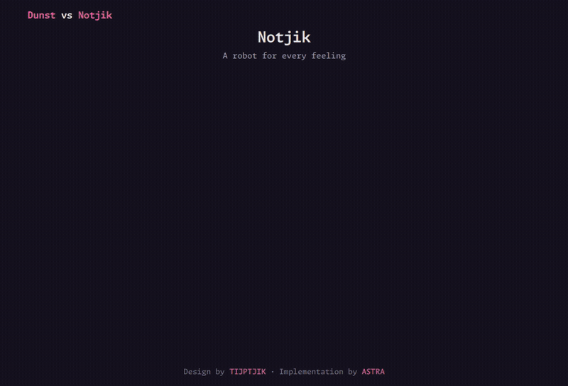
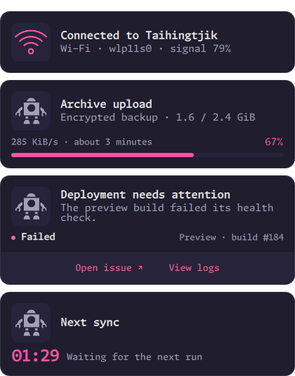
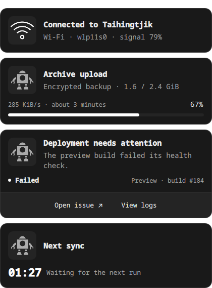
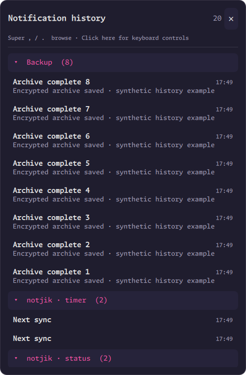
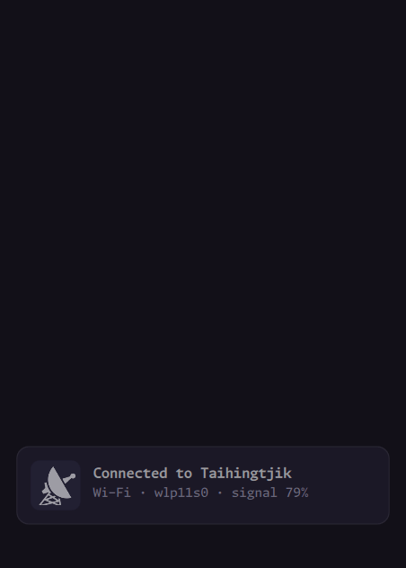

# Notjik

A Quickshell notification server with reusable QML cards, desktop notification
compatibility, command buttons, configurable placement and searchable local history.



[Install](#install-and-start) ·
[Card types and CLI examples](docs/cards.md) · [Configuration](#configuration) ·
[Telegram integration](#telegram-photos-and-voice-messages)

The showcase sends identical messages and artwork to both renderers. Messages
are synthetic; replies and voice recording are simulated.

| Rose-punk | Monochrome |
| --- | --- |
|  |  |

`notjik` owns `org.freedesktop.Notifications`. Quickshell handles D-Bus, image data,
icon lookup and standard action signals. QML owns the queue, timing, routing,
components and rendering. A small Python standard-library helper validates live
configuration and writes SQLite history; `notjikctl` talks to Quickshell IPC.

## Install and start

Requires **Quickshell 0.3.2+**, Qt 6 Quick/Controls and Qt5Compat GraphicalEffects, Python 3, `busctl`, and
Hyprland with layer-shell and `hyprland_lock_notifier_v1` support.
On unsupported compositors the lock state stays unknown and the default privacy
policy hides notices; an explicit `privacy.lockScreen: "show"` opts out of hiding. Bun is used
by the monorepo tooling. `tijpset` is the rose-punk font; Qt substitutes a font
when it is unavailable. No pip dependencies or separate notification daemon.

Clone the repository, then build only Notjik:

```sh
git clone https://github.com/tijptjik/tjikos.git
cd tjikos
bun install
bun run --filter @tjikos/notjik build
bash scripts/install.sh notjik
notjikctl init                     # default monochrome configuration
# Or, for a new configuration: notjikctl init --theme rose-punk
notjik
```

For source development, use `apps/notjik/bin/notjik` and
`apps/notjik/bin/notjikctl`. `notjik --config /absolute/path/config.json` selects
another config; set `NOTJIK_CONFIG` to that same path for `notjikctl config/init`.
`notjik --daemon` detaches. The foreground form suits a session service.

Only one desktop notification server can own the session bus name. The launcher
checks ownership and refuses to displace an existing notification server. To switch a
desktop session, stop its current notification service/autostart entry, then start
notjik. The installer deliberately does not start or enable either service. It also installs the standard D-Bus activation file
`~/.local/share/dbus-1/services/org.freedesktop.Notifications.service`. For
systemd startup, it installs `~/.config/systemd/user/notjik.service`; enable it
after removing the competing session startup. Ensure the user service manager has
the session's `WAYLAND_DISPLAY` and `XDG_CURRENT_DESKTOP` environment.

Waybar DND uses `notjikctl toggle`; its status poll reads `notjikctl status`.

### Start with your desktop session

After stopping the previous notification daemon and removing its autostart entry,
run these commands inside your graphical session:

```sh
systemctl --user import-environment WAYLAND_DISPLAY XDG_CURRENT_DESKTOP HYPRLAND_INSTANCE_SIGNATURE
systemctl --user daemon-reload
systemctl --user enable --now notjik.service
notjikctl status
```

Ensure `~/.local/bin` is on PATH. If notices stay hidden, inspect `notjikctl status`
and `journalctl --user -u notjik.service`; an unknown lock state hides cards by
default. The [privacy section](#lock-screen-privacy) explains the supported policy.

## Card types and calling Notjik

See the [card reference](docs/cards.md) for copyable examples of every type,
artwork, action buttons, grouping, urgency, persistent updates and Telegram previews.
Standard applications keep using the desktop notification D-Bus interface;
`notjikctl send` exposes the structured card data and local command actions.

## Sending and controlling

```sh
notjikctl send 'Backup complete' 'All files uploaded' --icon document-save-symbolic
notjikctl send 'Disk almost full' '/data has 2 GiB free' --urgency critical
notjikctl send 'Remember this' --timeout until-dismissed
notjikctl send 'Brief update' --timeout 1500ms

notjikctl send 'Deployment failed' 'Open the affected issue' \
  --type status --data '{"state":"Failed","detail":"Preview · build #184","tone":"critical"}' \
  --actions '[{"label":"Open issue","command":["xdg-open","https://example.com/issues/184"]}]'

id=$(notjikctl send 'Uploading' --type progress --data '{"value":10}' --timeout never)
notjikctl send 'Uploading' --replace "$id" --type progress \
  --data '{"value":67,"label":"285 KiB/s · about 3 minutes"}' --timeout never

notjikctl send 'Next sync' --type timer --data '{"seconds":90,"label":"Waiting for the next run"}' --timeout never
notjikctl pause
notjikctl resume
notjikctl toggle
notjikctl status
notjikctl monitors
notjikctl list
notjikctl dismiss local-1
notjikctl dismiss all
notjikctl action local-2 0         # invoke the first action
notjikctl demo                    # four-card overview beside Dunst
notjikctl demo list               # named visual variations
notjikctl demo actions-wrapped    # preview one layout
notjikctl demo next               # advance from the last shown type
notjikctl demo all                # cycle through every variation
notjikctl demo robots             # preview all robot artwork, one per second
notjikctl demo robots --interval 2s # slower robot preview
```

Do Not Disturb (pause) is saved in `preferences.json` under the Notjik state
directory (`$NOTJIK_STATE_DIR`, otherwise `$XDG_STATE_HOME/notjik`). Bar toggles,
`notjikctl pause/resume/toggle`, and the drawer's Resume button share this
preference. It survives app restarts, reboot, and managed configuration updates.
Configuration reloads do not reset it.


`send` prints the card ID. Local IDs use `local-N`; native desktop notifications
appear in `list` as `dbus-N`. Replacing a local card refreshes its content and
timeout, preserving its queue position. Native applications continue to use the
standard D-Bus `replaces_id` field. Local replacement IDs cannot modify native
notifications. IDs are scoped to a running server; history also records a session ID.

Cards display the sender-controlled title and body, without an application-name
header, close glyph or pinned badge. Application identity remains in grouping and logs.

### Sender-chosen persistent IDs

```sh
notjikctl send 'Backup upload' --app backup --id nightly \
  --type progress --data '{"value":10}'
notjikctl send 'Backup upload' --app backup --id nightly \
  --type progress --data '{"value":67,"label":"Uploading archives"}'
notjikctl send 'Backup complete' --app backup --id nightly --timeout 5s
```

`--id` creates or updates one card in place, scoped by `--app`. The CLI prints a
stable handle such as `named-backup/nightly`, usable with `dismiss` or `action`.
IDs accept 1–128 letters, digits, dots, underscores, colons, slashes and hyphens.
Named cards default to until-dismissed; an explicit `--timeout` overrides this.
Updates replace the complete payload, including actions and component data, keep
the original stack position, reset the requested lifetime/countdown, and log an
`updated` event. Different named cards remain separate unless explicitly grouped.
`--id` and `--replace` are mutually exclusive. Reusing a dismissed ID recreates it;
after a server restart the sender can publish the same ID again. This registration
does not execute jobs or automatically restore active cards after a restart.

Each custom action has a label and a **command argument array**. Execution does not
use a shell. If a shell is needed, request it explicitly with `['sh','-c',...]`.
Buttons invoke their command or the application's standard D-Bus action. Actions
dismiss the notification unless it is resident (`--resident` or the standard
`resident` hint). A standard `default` action appears as an explicit button.
Clicking any non-interactive part of a popup dismisses it. Drag that area instead
to detach the notice as a regular floating window on the current Hyprland
workspace. It stays on that workspace when you switch away; focus it to use the
usual move-to-workspace, move-to-monitor and close shortcuts. Floating notices stay open past their
original timeout, keep receiving sender updates, and gain a close button. Drag
any non-interactive area again to reposition them through the compositor, including
onto another monitor. New notices and sender updates preserve the detached window
and its workspace. The managed Hyprland `notjik-detached` window rule supplies the
initial floating style; only the initial drag preview uses a layer surface.
Action buttons, media controls and text editors retain their own
mouse gestures; clicking a floating panel's background leaves it open. Detaching
a grouped popup pins the displayed notice; its other messages remain in the stack.
The surrounding desktop remains interactive. Use the wheel, touchpad or scrollbar
to scroll a stack that exceeds the monitor height. `action`/`dismiss` provide keyboard-driven control through the CLI.

`--icon` accepts an icon-theme name or local image path; `--image` takes precedence
as the card artwork. Quickshell decodes standard `image-data`, `image-path`, their
legacy aliases, and application/desktop-entry icons. Symbolic icons ending in
`-symbolic` are tinted with the theme accent; other artwork retains its colors.
Standard `value` hints produce a progress card (0–100).

### Drag out and keep open

Drag a non-interactive part of a popup to place it anywhere, including another
monitor. The detached card stays until dismissed with **×**, a normal
non-resident action, or the sender closes it. Drag its background again to move it.
Clicking its background does not dismiss it. This works for ordinary notifications
as well as Telegram photos and voice notes; pinned cards leave the popup stack and
do not expire or get evicted by queue pressure. Positions are session-only.

Voice playback and unsent reply text survive the move. Detached cards hide while
locked or notifications are paused; locking stops playback, which resumes only
when you press Play. If their monitor disconnects, detached cards move to the first available screen.
Action footers collapse completely while idle, including their divider and empty
space. A thicker centre 30% of the bottom border indicates available interactions.
Hovering or keyboard selection slides the section open; replies and recordings
keep it open while active. This applies to regular actions and Telegram cards,
including the comparison demos.

All notification actions share the quiet text-button style with visible keyboard
focus, wrapped long labels and paged overflow.

On Hyprland, disable compositor animations for the `notjik-floating` layer namespace
so drag previews follow the pointer immediately. The managed Tijpfiles layer rules
include this setting (`no_anim = true`).

## Configuration

The file is `$XDG_CONFIG_HOME/notjik/config.json` (normally
`~/.config/notjik/config.json`). Missing options use defaults. Changes to the
configuration or selected theme JSON are detected within about a second; invalid
edits retain the last good configuration and are reported by `notjikctl status`.
`notjikctl config` prints the validated effective configuration; `notjikctl reload`
restarts the config/history helper. Config reload preserves current cards.

```json
{
  "theme": "rose-punk",
  "style": { "width": 420, "font": "tijpset", "radius": 14 },
  "placement": {
    "monitors": "primary",
    "primaryMonitor": "",
    "edge": "b",
    "position": "c",
    "offsetX": 0,
    "offsetY": -24,
    "margin": 16,
    "perMonitor": {
      "2": { "edge": "t", "position": "r", "offsetX": "-2%", "offsetY": "2%" },
      "DP-1": { "edge": "b", "position": "c" },
      "HDMI-A-1": { "enabled": false }
    }
  },
  "timeouts": { "low": 5, "normal": 8, "critical": 0 },
  "pauseOnHover": true,
  "maxVisible": 4,
  "maxQueued": 100,
  "history": { "enabled": true, "maxEvents": 10000, "maxAgeDays": 0, "logTransient": false, "drawerLimit": 100 },
  "grouping": { "enabled": true, "windowSeconds": 120 },
  "actions": { "blacklist": [] },
  "privacy": { "lockScreen": "hide" },
  "stack": { "animationMs": 220, "heightPercent": 75 },
  "components": {}
}
```

### Placement

`monitors` defaults to `"primary"`; it also accepts `"all"` or an array such as `[1, 2]`, `["DP-1"]`, or
`[1, "HDMI-A-1"]`. Numbers are **1-based**, using the order in `notjikctl monitors`.
`primaryMonitor` selects a preferred connector for `"primary"`; an empty or absent
connector falls back to the first screen in the compositor/Qt screen order. It
does not follow keyboard focus. The managed desktop sets `DP-1`, and the laptop
sets `eDP-1`. Connector names are recommended for arrangements that change when docking.
Per-monitor rules inherit global placement; connector rules override numeric rules.
Disconnected targets retain pending notices until a selected monitor returns.

| Setting | Meaning |
| --- | --- |
| `edge` | `t` top, `r` right, `b` bottom, `l` left |
| `position` on top/bottom | `l` left, `c` center, `r` right |
| `position` on left/right | `l` start/top, `c` center, `r` end/bottom |
| numeric `offsetX`, `offsetY` | Signed physical pixels; converted for the monitor scale |
| percentage offsets | Percent of that monitor's width/height, e.g. `"-2%"` |
| offset direction | Positive X moves right; positive Y moves down, regardless of edge |
| `margin` and style sizes | Logical UI pixels, matching Qt/Wayland scaling |

Offsets apply after anchoring; the stack is clamped to the screen. `all` mirrors
the same notices across selected monitors. Dismissal, actions and timeout are shared,
so a click on one monitor also removes the other copies. Hotplug is handled through
Quickshell's screen model. Each monitor gets one vertical stack.

### Actions per caller

Native action buttons come from the Freedesktop notification protocol. Set
`"actions": {"blacklist": ["telegram"]}` to hide all actions from selected callers
and disable their keyboard and IPC invocation. Entries match either the application
name or desktop-entry ID exactly, ignoring case and surrounding whitespace; there
are no substring matches or wildcards. Local CLI notices match their `--app` name.
The default empty list allows all callers. This controls actions only; cards,
dismissal and history remain available. Live config reloads apply to existing and
queued cards too; removing an entry restores their original actions.

### Timing and queuing

Low, normal and critical urgency match the desktop specification. Configured
defaults are **seconds**; `0` means until dismissed. Senders override defaults:
native D-Bus uses milliseconds (`-1` default, `0` persistent); the CLI accepts
`default`, `never`, `until-dismissed`, or durations such as `8s`, `500ms`, `2m`.

Pause hides the stack and queues incoming notifications. Lifetimes count only
while the display is active, including timed notices behind `maxVisible`.
Pause, lock, an open history drawer, and hover freeze expiration. Keyboard selection
freezes the selected card. Hovering any mirrored copy freezes all copies. Suspend
does not consume the whole remaining timeout on wake.

The stack displays at most four groups, keeping existing groups in place. New
groups wait for a slot to open, oldest first. A card also waits until its full
height, fully expanded hover buttons, and gap fit within the stack height limit. A bar between the stack and its
screen edge remains visible while additional groups are queued. Countdown components show
wall-clock time independently of display lifetime. Persistent notifications remain
until dismissal, sender close, or a non-resident action.

At `maxQueued`, the oldest timed notification is expired to admit another. If all
queued cards are persistent, new local sends fail with an explicit queue-full
error; native arrivals are closed and recorded as `overflow`. Existing persistent
cards are preserved. Changing timeout defaults affects future sends/replacements.

### Styling and components

The built-in themes are [`monochrome`](themes/monochrome.json) and
[`rose-punk`](themes/rose-punk.json). `theme` also accepts a path to a full theme JSON,
relative to the configuration file or absolute. `style` overrides individual
tokens: colors, font, font size, radius, padding, gap, border width, icon size,
card width and maximum body lines. Rose-punk follows the existing Quickshell Wi-Fi
panel's purple surfaces, soft borders and pink accents.

Built-in card types:

| Type | Data |
| --- | --- |
| `standard` | Title, body, artwork and actions |
| `progress` | `value` (0–100), optional `label` |
| `status` | `state`, optional `detail`, `tone` (`critical`, `success`, or accent), optional `rainbow-text` |
| `timer` | `seconds`, optional `label`, `doneLabel` |
| `results-table` | `results` rows with optional `ingredients`; footer `state`, `tone`, `duration`. See [results tables](docs/cards.md#results-tables). |
| `telegram` | Bridge-managed text, photo, voice, sticker, emoji and animation data; see [Telegram setup](#telegram-photos-and-voice-messages) |

Register a QML detail component in `components`, e.g.
`{"issue":"components/Issue.qml"}`. Paths resolve relative to `config.json`.
Copy [`examples/Issue.qml`](examples/Issue.qml) to that location, then:

```sh
notjikctl send 'Health check failed' --type issue \
  --data '{"number":184,"project":"Preview deployment"}' --timeout never
```

The component receives required properties `notice` (including `data`), `theme`
and `now` (epoch milliseconds), and supplies `implicitHeight`. The card provides
the shared header, body, artwork, dismissal behavior and action buttons. User QML
is trusted local code. Senders select registered component names; a notification
cannot supply a QML file path or register executable code. Ordinary D-Bus hints
cannot execute commands. QML source edits may require restarting notjik because
Qt caches loaded components.

## History and keyboard navigation

```sh
notjikctl history show             # also: hide, toggle
notjikctl navigate previous        # older
notjikctl navigate next            # newer
notjikctl unfocus                  # release popup keyboard focus
notjikctl send 'Build started' --app builder --group project-a
```

The managed Hyprland bindings pair **Super+M** with Waybar's reveal/pin toggle and
show/hide this drawer. **Super+,** selects an older notice; **Super+.** selects a
newer one. Without active notices these open history. Navigation wraps around.
The drawer opens on the focused configured monitor with groups collapsed and the
list at the top. Expand a group for compact rows; select a row for full details.
It uses on-demand focus. After focusing the drawer, clicking another app closes
it; selected popup keyboard mode also clears when focus leaves.
After clicking the drawer or a selected popup, Up/Down also browse, Enter
invokes the first live action, Tab focuses buttons, Delete dismisses the selected
live notice, and Escape closes history or releases popup keyboard focus. Ordinary
popups never take keyboard focus automatically. Super+, / Super+. still select
notices globally; click the selected popup to use its local keyboard controls.
Press **/** in the focused drawer to filter the loaded history as you type.
Search ignores case and matches every typed word across the title, body, app,
desktop-entry and group name. Matching groups expand automatically; their counts
and the header reflect matching notices. Up/Down and global navigation stay within
the results. **Tab** selects the next match in list order; **Shift+Tab** selects
the previous match, wrapping at the ends while leaving the query editable.
These keys also browse after Enter leaves the search field. Escape clears the search
first, then closes the drawer on the next press. Reopening starts unfiltered.
A paused service shows a Resume button in the drawer. Use `notjikctl status` to
check delivery state, or `notjikctl resume` to resume queued notifications.

Related popups group by application/desktop-entry and optional `--group` key within
`grouping.windowSeconds`. Each original notification keeps its own ID, actions and
lifetime. The newest member represents the group; keyboard navigation can select
an older member. Grouped cards use vertically centred notches at 10 px spacing along the right edge instead
of a text count: one per message, capped at five. The marks split and merge as the
count changes: three to two divides the middle notch between its neighbours; two
to three reverses that motion. A change during animation continues from the current
positions. Counts above five keep the same five marks, and `stack.animationMs: 0`
disables the morph. Group marks are informational and their accessible label retains
the exact count. Clicking a grouped card, including its notch strip, dismisses only
the displayed message, revealing the next member. Hovering never opens history;
open history explicitly with Super+M. Single
notices have no group marks. The drawer groups
saved notices by application and group key across time, with expandable headings.
Set `grouping.enabled` to false to show separate cards.

Newest announcements appear at the bottom and push older cards upward. Every
settled card remains full-size and fully opaque, regardless of its age or urgency.
Arrivals fade in from 97% scale as the upward push settles; dismissed/expired
cards shrink and fade before their space closes. The `stack.animationMs` option controls transition duration and `heightPercent`
limits the scrollable stack height. Borders use a subtle theme color; critical
urgency accents the content rather than adding a bright outline. Legacy depth-scale
and depth-opacity options are ignored. The defaults use bottom-centre placement
with a 24-pixel upward offset plus the outer margin.

### Lock-screen privacy

`privacy.lockScreen` accepts `hide` (default), `redact` (generic count-free placeholder),
or `show` (normal popup content). A read-only Hyprland protocol observer detects
lock/unlock, including starting while already locked. Unknown/disconnected state
fails closed under `hide`/`redact`. Locking closes history and releases keyboard
selection; history and actions are unavailable while locked under every policy.
Timeouts pause until unlock. The compositor still controls which surfaces it permits
above a lock screen: `show`/`redact` do not bypass Hyprlock or create lock surfaces.
This affects presentation only; notifications can still be recorded in local history.

### Persistent log

```sh
notjikctl logs
notjikctl logs --limit 200 --app 'notjikctl'
notjikctl logs --event action --since '2026-10-25T00:00:00Z'
notjikctl logs --json
notjikctl logs --follow
```

History is stored at `$XDG_STATE_HOME/notjik/history.sqlite3`, with a private
directory (0700) and file (0600). `NOTJIK_STATE_DIR` overrides the directory.
Events include received, updated, action, dismissed, expired, sender-closed and
overflow notices. Logs retain content, component data and action labels, but not
command argument arrays or binary artwork. The default retains 10,000 events.
`history.enabled: false` disables recording; transient notifications are excluded
unless `history.logTransient` is enabled. Existing history is not deleted when
logging is disabled. `logs` works while notjik is stopped; `--json` exposes full
structured records. Terminal output strips control characters.

The managed desktop keeps a rolling seven days of events, with no fixed count
or drawer cap:

```json
"history": {"maxAgeDays": 7, "maxEvents": 0, "drawerLimit": 0}
```

`maxAgeDays: 0` disables age expiry; `maxEvents: 0` disables the event-count cap.
At least one retention limit must be positive. When both are set, both apply.
Expiry uses the event's recorded UTC time and runs on writes, config reload, startup
and once a minute while idle. `drawerLimit: 0` loads all retained notifications,
so search covers the whole retained history; a positive value caps the drawer.

The drawer shows the latest snapshot per notification/session (up to
`history.drawerLimit` when nonzero), while `logs` shows individual events. Live records retain
their current actions; archived records have no executable actions.

History is an audit record: it does not recreate actions or replay commands after
the sender/server exits. Pending cards are in memory; restarting the server clears
them. Native in-memory image URLs may no longer resolve after a notification closes.



## Compatibility boundaries

Standard title/body text, three urgencies, images, replacement, expiration,
resident/transient hints, actions, `ActionInvoked` and `NotificationClosed` are
implemented through Quickshell. This version advertises plain body text and image
support; rich body markup, inline replies, sounds and action icons are not advertised.
Vendor-specific extensions are outside the standard compatibility contract.

Quickshell 0.3.2 exposes property-change signals for replacements, but no separate
signal for a byte-for-byte identical native resend. Changed native content resets
the timeout; an entirely identical resend may not. Local `--replace` always resets
it. A future Quickshell update with an explicit replacement event would close this
gap without a D-Bus proxy.

Richer per-application routing remains a possible extension.

## Interactive demo types

```sh
notjikctl demo list
notjikctl demo icon
notjikctl demo telegram-grouped     # text, photo and voice from one chat
notjikctl demo telegram-text telegram-photo telegram-voice
notjikctl demo image               # bundled full-colour album artwork
notjikctl demo actions actions-multiple actions-wrapped
notjikctl demo all --interval 4s
notjikctl demo actions --solo
notjikctl demo clear
```

`demo next` advances in `demo list` order and wraps after the final type. It starts
with `standard` if nothing has been shown. Named demos and the overview update
the cursor to their last successfully shown type; clearing cards keeps the cursor.
Paired and `--solo` previews track their positions separately.

`demo` (or `demo overview`) shows the four-card overview beside Dunst by default.
The command automatically starts or reuses the isolated comparison: Dunst on the
left and notjik one card width plus 40 pixels to its right on the same monitor. If the optional
Dunst reference is unavailable, it prints that limitation and uses normal notjik.
Use `--solo` to select the normal service explicitly. Named types stay visible
until dismissed, except `timeout`, which expires after 2.5 seconds. `--timeout 12s`
overrides the lifetime; `--timeout never` holds a timed example too. `all` cycles
one type at a time, replacing the preceding demo so the display limit does not
hide later examples. Ctrl+C stops the cycle and leaves the current type visible.

Available types:

| Area | Demo types |
| --- | --- |
| Text and artwork | `standard`, `title-only`, `icon`, `missing-icon`, `image` |
| Telegram | `telegram-text`, `telegram-photo`, `telegram-voice`, `telegram-sticker`, `telegram-animated-sticker`, `telegram-gif`, `telegram-animated-emoji`, `telegram-custom-emoji`, `telegram-grouped` |
| Progress | `progress`, `progress-empty`, `progress-complete`, `update` |
| State | `status`, `success`, `warning`, `error` |
| Timers | `timer`, `timer-done`, `timeout` |
| Buttons | `actions`, `actions-multiple`, `actions-wrapped`, `resident` |
| Content | `multiline`, `long`, `unicode`, `markup` |
| Multiple notices | `urgency`, `grouped`, `stack` |

Each invocation clears only cards from **notjik demo**. Use `--append` with named
types to keep existing demo cards; repeated types update their stable IDs.
`demo clear` removes both halves of paired demos, leaving other senders and
manually sent comparison fixtures untouched. `demo clear --solo` clears demos
from the normal service. Demo actions execute only `true`; the Dunst reference
carries action labels and emits native signals without running commands. No browser,
service or real application is opened. Demos are transient by default. Use
`demo grouped --log` to review grouped history in the isolated demo drawer, or
add `--solo` to explicitly retain those synthetic notices in normal history.

Paired demos use your current theme, width, typography and custom components.
Their copied UI refreshes on the next demo after installed code or config changes.
Solo demos also use your normal placement. Neither mode changes production configuration
or resumes DND. Starting a demo closes its own history drawer so cards are visible.

Titles, bodies, icons/images, urgency, timeouts, progress hints, actions, resident
behaviour and replacement IDs are sent to Dunst through the standard notification
interface. Status details and timer values are represented as text on the Dunst
side; a live countdown, inline status styling, action footer and grouped history
are notjik features. Each demo prints those differences rather than implying
visual or behavioural parity. Dunst actions use middle click/context menu rather
than notjik's visible buttons. Repeated named demos map each server's replacement
ID independently, including across `--append` invocations.

`notjikctl compare case NAME` remains available for identical native notify-send
payloads. It resets demo grouping to preserve the original comparison fixtures.
`notjikctl compare stop` closes both isolated servers when finished.

## Directed comparison cycle and recording

```sh
notjikctl demo cycle
notjikctl demo record ~/Videos/notjik-demo.mp4
notjikctl demo record ~/Videos/notjik-secondary.mp4 --monitor DP-2
notjikctl demo cycle --plan
notjikctl demo record /tmp/telegram-demo.mp4 --only telegram-text telegram-voice --speed 0.75
```

The cycle opens with a two-second montage with 15 staggered, animated card reveals and varied robot
portraits, then fades into the comparison. The directed cycle shows standard,
icon, status, error, timer, multiple actions,
all three urgency levels, in-place updates, grouped messages, and Telegram text,
photo, voice and GIF cards, followed by the 12 selected robots (four everyday, four urgent and four dream) at a fixed
0.25-second interval. The standalone `demo robots` command still shows the full
gallery. Every scene has an intro, a settled view and a complete
outro before the next scene starts. A visible pointer uses Qt's test input to
hover both action buttons, click the error action, compose text and quote replies,
mark a photo read, play two seconds of voice, and simulate recording/sending a
3.2-second reply. Maya uses a dream robot portrait. Grouped messages open a
populated notification center backed by the private demo history.
The shared production QML supplies the actual controls and transitions.

Each run creates its own private Dunst and Notjik comparison session. It never
clears production notifications or changes the ordinary `demo`/`compare` session.
Only bundled synthetic fixtures are used. Telegram replies are simulated, playback
is muted, and the recording helper and Telegram bridge are disabled in the private
copy. No microphone is opened and no message is sent, including to Saved Messages.

`cycle` presents a centered 1000×680 stage on the focused Hyprland output. `record` creates and records a
1000×680 headless output at 60 fps, then removes that output and both comparison
servers. Use `--monitor DP-2` to record the centered demo area on an existing screen
with wf-recorder. Recordings capture lossless RGB first, then encode once at CRF 14 with the slow
preset. The final H.264 4:2:0 MP4 uses fast-start for player
compatibility. The MP4 contains the synthetic stage, not the desktop. It also writes a
`.chapters.json` file with scene timings. Existing output files are never overwritten.
Capture waits 2.5 seconds for the compositor backdrop transition to settle.
Ctrl+C closes the private session and discards an incomplete recording.

Requirements: Hyprland, Quickshell with QtTest, a Dunst reference binary (the same
one used by `compare`), and `wf-recorder` plus FFprobe for recording. `--speed` is a
duration multiplier from 0.1 to 4; the default keeps the voice interaction short.
`--only` selects scenes in the supplied order. Dunst receives equivalent standard
notification fields; the stage labels the media, timer and inline-action features
that are specific to Notjik.

## Rose-punk demo



The recording uses synthetic cards only: arrivals, solid settled cards, an upload
updated in place, and animated removal. Regenerate with Quickshell, Pillow and an
active Wayland session:

```sh
bun run --filter @tjikos/notjik demo
```

## Native-notification comparison

`notjikctl compare start` runs isolated Dunst and notjik reference instances side
by side. The test notjik stack is offset one configured card width plus a 40-pixel gutter right; production
placement and bus ownership are unchanged. The optional Dunst binary is only a
comparison tool, not a runtime dependency. See the [comparison commands, fixtures
and known capability gaps](docs/comparison.md).

```sh
notjikctl compare case basic
notjikctl compare case replace
notjikctl compare send -- -u normal -t 8000 'Connected' 'Wi-Fi is ready'
notjikctl compare clear
notjikctl compare stop
```

## Validation

```sh
bun run --filter @tjikos/notjik check
bun run --filter @tjikos/notjik test
cd apps/notjik
dbus-run-session --config-file tests/bus.conf -- python3 -B tests/integration.py
dbus-run-session --config-file tests/bus.conf -- python3 -B tests/privacy.py
dbus-run-session --config-file tests/bus.conf -- python3 -B tests/history_search.py
dbus-run-session --config-file tests/bus.conf -- python3 -B tests/demo_acceptance.py
dbus-run-session --config-file tests/bus.conf -- python3 -B tests/paired_demo_acceptance.py
dbus-run-session --config-file tests/bus.conf -- python3 -B tests/render.py /tmp/notjik-previews
dbus-run-session --config-file tests/bus.conf -- python3 -B tests/render.py /tmp/notjik-motion --motion
dbus-run-session --config-file tests/bus.conf -- python3 -B tests/render.py /tmp/notjik-groups --groups
```

Unit checks cover configuration, retention, terminal output, action validation and
geometry, primary-screen selection, named updates, grouping, history snapshots and lock-protocol transitions. The explicit acceptance run uses a private bus with no desktop-service
activation and briefly shows synthetic cards on the current Wayland compositor;
it does not replace the normal notification server. The render helper captures
only QML items from a temporary instrumented copy, never other desktop content.

The history search check injects keys into a temporary drawer on the private bus,
covering filtering, editing, Tab/Shift+Tab result navigation, group counts and Escape. It uses
synthetic notices and cannot send keystrokes to other desktop applications.

The render test asserts full settled opacity, exact card bounds and gaps before
capturing previews. It checks only its own QML content, never desktop pixels.

For manual interaction acceptance, open history, click a group, then click another
application and type. Repeat after selecting a popup with Super+comma. Both apps
should receive input normally; notification focus must never trap the desktop.

Notifications without sender artwork use the bundled vintage robot icon. Sender
images and icons take precedence, except terminal command reports. Kitty uses
random robot artwork; Fish uses a uniform random choice from 28 cybernetic fish
illustrations. The chosen fish persists by stable name across updates and notification history. Legacy indices map to surviving species; deleted artwork receives a deterministic replacement.
Original high-resolution PNGs and generation prompts are in `qml/icons/fish/`. See [artwork attribution](qml/icons/README.md).

The default icon container is 56 pixels (`style.iconSize`). Actions fill a centred footer row. Named icons use the Qt platform theme; a service launched
without your desktop theme settings may not find the same icons as your shell.
On the managed desktop, the service inherits `QT_QPA_PLATFORMTHEME=qt6ct` through
a user service override. Missing theme icons fall back to the bundled robot.

Cards use consistent content padding and a separate, subtly divided action footer
only when actions are available. Status details render inline, countdowns use a
smaller numeral size, and fallback robot artwork uses the muted theme colour.

When actions overflow, chevrons slide to the next or previous page of buttons.
Each page fits as many actions as space allows, preserving sender order. A long
label wraps inside its button, and the footer height stays steady across pages.

The image demo uses a bundled PNG album cover, supplied alongside an icon to
verify sender-image precedence. See [artwork provenance and prompt](examples/demo-artwork.md).

Notification presentation uses muted low-urgency text/artwork, neutral normal
titles/artwork with muted body text, and the theme's critical color for critical
titles. Critical body text, fallback artwork and secondary component labels
use the theme's primary text color (white in rose-punk). Sender images retain their colors. Wireless symbolic icons
use the bundled Lorc radar-dish artwork, with sender images taking precedence.
Bodies remain plain text: list/prose boundaries receive a blank line, with 1.22
line spacing. The configured body-line limit still applies.

`stack.animationMs` (default 220ms) controls the response speed. A burst uses one
continuous upward movement, preserving velocity when more notices arrive and
slowing down as the queue empties. Cards enter oldest-first as the preceding card
makes room. Their measured heights determine the timing; there is no fixed stagger
or independently restarted push for each card.
The first card fades in at the bottom before the stack moves. Waiting cards occupy
no space or gaps. Incoming cards appear in front of older cards, with a solid backing
that prevents their text blending together during the brief fade. Settled cards keep
their full size and opacity. Visible departures clear before new arrivals enter;
queued notices dismissed before entering are removed without a ghost animation.
Reusing an ID after dismissal creates a fresh entrance; updating a still-active ID
keeps its current card. Set `animationMs` to zero for immediate presentation.
On dismissal the card drops down up to 28 pixels, recedes to 90% size and fades
behind the surviving stack before its space closes. Its starting position is
frozen so layout changes cannot pull it upwards. Resting desktop padding stays
the same; only the noninteractive exit layer extends below the stack. Cards are never revealed through a growing
clip; settled cards stay full-size.

Live Telegram notifications use their avatar as an “open chat” target. This invokes
Telegram's native `default` action, which retains the originating chat/message;
no chat identifier is guessed from the sender's display name. It remains available
when Telegram's footer buttons are hidden by `actions.blacklist`. That exception
only opens the chat: reply/mark-read buttons and arbitrary local commands remain
blocked. Archived notifications and the lock screen never activate this action.
Telegram's native notification payload does not contain attachments or playback
controls. The optional TDLib bridge below supplies media through its own account session.


## Structured notification handlers

`handlers` is an ordered registry of presentation rules. Each rule combines a
source selector, a full-body regular expression, numbered captures and a card
renderer. The first complete match wins. See `examples/handlers.json` for the
StarProwlarr grab template; copy its `handlers` array into your configuration.

- `match.telegram: true` recognizes both Desktop and bridge transports.
  `match.title` selects an exact chat title. `match.chatId` selects a stable
  bridge chat ID, but intentionally cannot match Desktop payloads without that ID.
  `match.app` selects an exact app name or desktop entry (case insensitive).
  All supplied selectors must match. These selectors control presentation only;
  display names are not authentication and matching never grants actions.
- `pattern` uses JavaScript regular-expression syntax with numbered capture
  groups (the portable Python/JavaScript subset is validated). It must match the
  entire body after outer whitespace and CRLF normalization. Use explicit line
  separators; unexpected message formats remain unchanged.
- `captures` maps data names to capture numbers. Every capture must be nonempty.
  `card: "key-value"` renders `heading` plus `fields` entries containing `label`
  and a captured `key`. A registered `components` name may select another QML
  renderer; it receives the captured values as `notice.data`.

Handlers format standard text and Telegram text messages only. The original
body, transport type, ID, avatar, grouping, action policy and Telegram controls
remain intact, including in history. Values render as literal text. Removing a
rule restores ordinary rendering. Rules neither deduplicate notifications nor
change delivery. Invalid templates fail configuration validation; a renderer
that fails to load falls back to the original body. The registry is local trusted
configuration, not patterns supplied by incoming messages.

## Telegram photos and voice messages

Bridge notifications preserve Telegram's bold, italic, underline, strikethrough,
monospace/code and underlined link entities, including captions and text around
custom emoji. Nested styles and emoji offsets are supported. Links are visual;
use Open to follow them in Telegram. Literal Markdown and HTML remain literal.
Messages containing text spoilers show an Open-in-Telegram placeholder, including
in history. Native Desktop notifications cannot recover entities omitted by Telegram.

The optional bridge receives TDLib notification updates, respecting Telegram's
notification/mute and preview settings. It displays ordinary messages too, while
Telegram Desktop remains an independent notification delivery path.
It does not poll the inbox or reuse Telegram Desktop's `tdata`.

Build/install Notjik normally, then install its optional pinned runtime:

```sh
notjikctl telegram setup
notjikctl telegram doctor
notjikctl telegram login
systemctl --user daemon-reload
systemctl --user enable --now notjik-telegram.service
notjikctl telegram status
```

`setup` uses `uv` and `/usr/bin/python3` to create a separate virtual environment
at `~/.local/share/notjik/telegram-venv`. Qt Multimedia is also required by the
notification UI. Voice replies also require `ffmpeg` and `ffprobe` with PulseAudio
input and Opus support (PipeWire provides the PulseAudio input). The pinned `tdjson` wheel bundles TDLib; it is a third-party
Python binding, not Telegram Desktop itself.

`login` runs interactively in a terminal. Create your own API ID/hash at
<https://my.telegram.org/apps>, then enter them, your phone number, the login code,
and your two-step verification password when prompted. Never put these values
in repository files, command arguments, or chat. The bridge is a separate Telegram
session named **Notjik**. The installer supplies its service but does not enable it
or sign in automatically. Stop `notjik-telegram.service` before signing in again;
an exclusive lock prevents two processes from opening the same TDLib database.

The bridge is the primary chat-notification route while its online delivery lease
is healthy. Notjik suppresses Telegram Desktop's `im.received` alerts during that
lease; calls and other categories remain native. Keep Desktop notifications enabled
as fallback when the bridge disconnects or cannot publish. This routing assumes
the bridge covers the Desktop account whose chat alerts it replaces. Existing
focus suppression still applies; no title/body matching is used.
`notjikctl status` includes `telegramDelivery` counters for native arrivals and
focus/bridge suppression. `notjikctl telegram status` includes verified `online`
state and `delivery` counters for
bridge events, filtering and publication failures. Counters reset on service
restart and contain no message text. A successful publication means the UI
accepted the request, not that the user saw the card.

Photos appear as previews up to 1280 pixels. Voice cards have Play/Pause, a seek
slider and 1×/1.25×/1.5×/2× speed controls. There is one shared player across cards
and monitors. Playback requires a click, stops when its card is dismissed or its
component is removed, and stops on desktop lock or notification pause. Archived
cards do not animate, play audio or execute actions. Media and custom-emoji cards stay until dismissed;
ordinary text cards expire after 12 seconds. Showing/downloading/playing media does
not mark it read; **Mark read** is explicit.

**Quote reply** opens a composer targeting the specific message. **Reply** sends a normal chat message. Use Send
reply or Ctrl+Enter; text is literal and Telegram Desktop drafts remain intact.
After TDLib accepts a text send, the notification closes. Failures retain the
card and draft; acceptance does not confirm delivery. Demo text sends close the
card without contacting Telegram.
**Record** closes the text editor (preserving its draft) and starts a voice reply
using the default microphone. **Send** ends capture
and sends it as a voice-note reply to the originating message; **Reset** cancels
and discards it. Recording alone never sends a message. One draft is allowed at a time, with a five-minute recording cap.
Recording stops incoming playback; locking or pausing stops capture and retains
the draft for review after unlocking. Recording survives detachment
and native window moves. The card stays visible and does not expire while it
holds a draft. Closing the card, removing its Telegram notification or exiting
Notjik discards the draft. The detached window fits the current card height as
controls open or close.

Drafts are private Ogg/Opus files under `$XDG_RUNTIME_DIR/notjik-voice` and are
removed after send acceptance or discard. Before sending, the bridge makes a
private copy in `~/.local/state/notjik/telegram/voice-outbox`, retaining it until
TDLib confirms upload completion. Pending upload copies survive a bridge restart.
“Voice reply queued” means TDLib accepted the send; “Voice reply sent” requires
TDLib's send-success update. A rejection keeps the draft available. If the send
has no confirmation, automatic retry is disabled to avoid duplicates; check
Telegram before recording another reply. Failed or unconfirmed upload copies
are retained for Telegram to recover; at most 20 pending copies are allowed.

**Open** uses a message link where Telegram supports it; private users can be
opened through their username or phone when available. Other private/basic-group
chats fall back to opening Telegram with an explanatory status. The bridge never
matches a message using a display name. These are the bridge's own controls under
caller `Telegram via Notjik`; the existing native Telegram action blacklist stays
unchanged. Blacklisting `Telegram via Notjik` also disables its controls.

A healthy online bridge renews a 12-second lease in Notjik every second. It sets
TDLib online only while Notjik is reachable, unpaused, and the desktop is unlocked;
lock, unknown lock state, pause, or UI failure requests offline on the next check.
This can make the account appear online and avoids TDLib's roughly 30-second
offline-client notification delay when another Telegram client is online. TDLib
may still apply its shorter cross-client delay. The bridge verifies the presence
option before taking over chat alerts. Old unread messages
are not replayed on startup. Telegram read/delete updates remove matching live cards.

Hidden notification previews, spoilers, protected media and self-destructing media
are kept as text directing you to Telegram. Downloads are limited to 20 MiB each.
Account credentials, a random database encryption key, TDLib's database and files
live under `~/.local/state/notjik/telegram` with private permissions. TDLib manages
its own cache (seven-day retention and a 256 MiB target, with a one-hour grace
period); expired files show an unavailable-media state. Notjik's existing history
policy still governs captions and local attachment paths. One account is supported.

For troubleshooting, use `notjikctl telegram doctor`, `notjikctl telegram status`,
and `journalctl --user -u notjik-telegram.service`. `NOTJIK_TELEGRAM_DIR` overrides
the private state directory and `NOTJIK_TELEGRAM_PYTHON` overrides the runtime
interpreter. `NOTJIK_TELEGRAM_SOCKET` exists for isolated tests. Stop and disable
`notjik-telegram.service` to return to native Telegram notifications. No Telegram
Desktop settings need to be changed.

Validation without an account:

```sh
python3 -B -m unittest discover -s tests -v
dbus-run-session --config-file tests/bus.conf -- python3 -B tests/telegram_media.py /tmp/notjik-media-preview
```

The media acceptance run uses a synthetic photo, a silent Opus recording, and a
fake local control socket. It verifies actual QML rendering/playback, pause/seek/
speed, no autoplay, update continuity, literal reply transport, lock/archived
behavior and native fallback. Recording tests replace the microphone with generated
silence and cover send/reset, failed-send draft retention, lock stop,
detachment and temporary-file cleanup. They never open a microphone, connect to a
Telegram account or send messages. Real microphone capture and voice-note delivery
require a separate user-driven check.

Native notification actions can run additional local commands via `actions.nativeHooks`:
`{"caller":"chatgpt","identifier":"default","command":["/path/to/show-codex"]}`.
Caller matching uses app name or desktop entry, ignoring case and whitespace;
action identifiers match exactly. Hooks run after native delivery and respect
the action blacklist and lock restrictions. Commands are argument arrays, without shell expansion.

Action footers place the native default action (or first supplied action) on the right,
with secondary actions on the left. Overflow retains paging and original action identities.

Telegram voice cards render Telegram’s supplied 5-bit waveform peaks above the duration.
Played peaks use the accent colour; the waveform retains the player’s seeking and keyboard controls.
Waveforms are ready with the notification metadata, before audio download completes.
Missing or malformed waveform data falls back to a plain seek bar. Hidden previews remain text-only.

Telegram demos use bundled synthetic media. Voice playback, seeking and speed work;
Reply, Mark read and Open are simulated. Record uses the microphone only when
clicked; Send finishes and sends to Saved Messages, while Reset cancels the draft.
The bridge verifies the signed-in account is @tijptjik before a demo voice send.
Viewing demos requires no login; sending a demo recording requires the connected
Telegram bridge. The demos participate in `list`, `next` and `all`.

Telegram cards fetch the chat’s small profile photo through TDLib and update it
in place. Initials remain the fallback for missing, loading or unavailable photos.
Avatar downloads use the same private cache and size limit as attachments.

Voice cards offer **Transcribe**, using Telegram’s own speech recognition after
checking message eligibility. Partial and final text appear below the waveform;
Telegram account limits and errors are shown inline. Hidden previews stay hidden.
The demo Transcribe button displays synthetic text without contacting Telegram.

Telegram card actions use 20 px icons in 30 px buttons, with accessible names and no tooltips.
Mark read, Record, Quote reply and Reply appear in that order; send buttons align right.
The demo recording controls identify Saved Messages (@tijptjik) as the recipient.

Telegram notification buttons appear only while the card is hovered or its panel
has keyboard focus. Hidden controls do not accept input, and their layout space
is retained so hovering does not resize the card.

Telegram media cards render WebP stickers, TGS and WebM animated stickers,
GIF/MP4 animations, standalone animated emoji and inline custom emoji in text
and captions. Ordinary Unicode emoji retain the system font rendering.
Animations loop silently while visible, and stop when hidden, locked or paused;
voice messages still require Play. Spoilers and hidden/protected previews stay hidden.

The optional Telegram runtime includes `rlottie-python`; FFmpeg performs bounded
local conversion to PNG/GIF for Qt compatibility. Rendering runs outside the bridge
receive loop, with two workers and a bounded queue. Rendered derivatives are private
under the Telegram state directory, retained for seven days with a 256 MiB target;
active sources stay available. Downloads retain the existing 20 MiB limit.
Run `notjikctl telegram setup` after upgrading to install the renderer dependency.

Partial Telegram transcription updates replace the transcript in the same card
immediately, preserving the loaded audio, playback position and card identity.
Update frequency depends on the partial results Telegram supplies; text is not
artificially replayed word by word. Final text and errors arrive through the same path.

Preview the new media with:

```sh
notjikctl demo telegram-sticker telegram-animated-sticker telegram-gif --solo
notjikctl demo telegram-animated-emoji telegram-custom-emoji --solo
```

Generated robot and Wi-Fi cover illustrations use an 80 px strip flush with the
left edge, cropped to fill the full card height without a height cap. Sender images and Telegram user avatars
use the same 80 px strip, clipped to the card corners.
They fill the full height as controls open or close. Missing avatars retain
the initials fallback; app icons keep their inset presentation.

Telegram notifications (native and bridge) are suppressed while a Telegram window
has keyboard focus. Focusing Telegram also dismisses its existing notices, so they
do not reappear when focus moves away. Other applications are unaffected.

Full-size Telegram profile photos are copied from bridge notifications into the private
Notjik state directory's `avatars/` cache (up to 512 chats). Both native Desktop
notifications and bridge cards use these photos and the same full-height rail.
The cache survives TDLib file eviction and notification history pruning; an upgrade
seeds it from existing bridge history. Bridge cards resolve by chat ID. Native
Desktop cards, which lack that ID, resolve by an exact, unique cached chat title;
ambiguous or unknown names retain Desktop's supplied image. New bridge photos
replace cached versions. Synthetic demos never populate or consult this cache.
