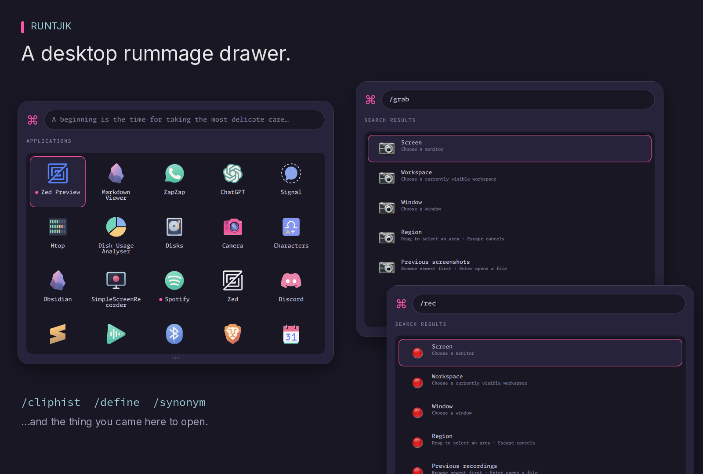
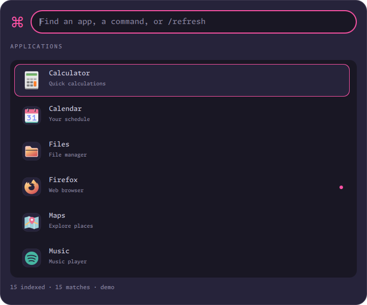
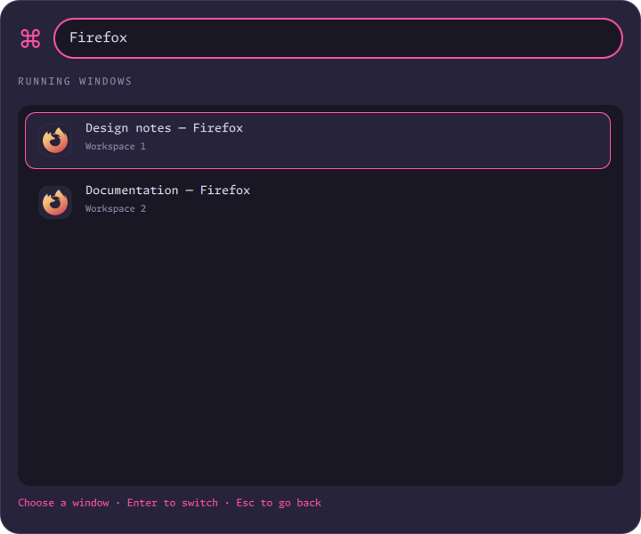
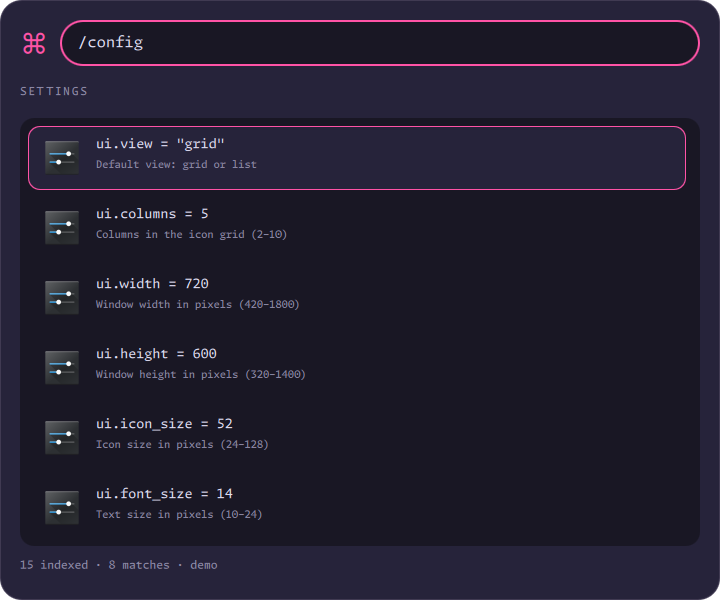
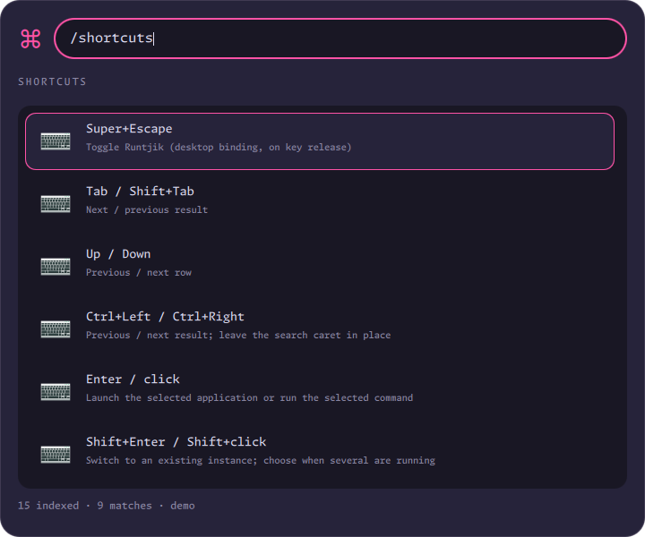

# Runtjik



A Quickshell top-layer launcher with an icon grid, fuzzy search, launch history,
and Hyprland window switching. The layout takes inspiration from
[Hamr](https://github.com/Stewart86/hamr); this implementation is independent.
Rose Pine surfaces and Rose Punk accents match Bartjik and Notjik.

## Motivation and measurements

Runtjik keeps the launcher focused on application/command discovery and switching.
One Quickshell process and one Python helper replace a resident UI, daemon and
plugin processes. Since 0.6.0, Quickshell and its Python helper stay resident after
the first opening so subsequent requests can reuse the UI and index. Dismissal
unmaps the layer, removes outside-click bindings and stops periodic index queries.
The tradeoff is idle RAM in exchange for faster reopening. `runtjik quit` releases
that RAM; `/config ui.keep_alive false` restores exit-on-dismissal behavior.

Measured on Fi on 2026-10-27, Hamr 1.1.0 (the installed GTK layout build) versus
Runtjik 0.2.0 / Quickshell 0.3.2, with the real 3,355-entry Runtjik index.
This historical baseline predates the Fish-history filter and top-layer presentation:

| Measurement | Hamr | Runtjik |
| --- | ---: | ---: |
| Fresh-process startup, median | 0.195 s | 0.315 s |
| Startup range, 5 trials | 0.192–0.661 s | 0.308–0.323 s |
| Open PSS, median | 274.6 MiB | 102.0 MiB |
| Open PSS range | 273.5–276.3 MiB | 101.0–102.5 MiB |
| Open summed RSS, median | 518.5 MiB | 242.1 MiB |
| Hidden/closed PSS, median | 274.6 MiB (resident) | No launcher processes |
| Resident hide/show, median | 0.029 s | Starts fresh each time |

This run used **63% less PSS while open**. Hamr mapped faster in these measurements;
Runtjik's motivation is reduced scope and resident memory, not a universal speed
claim. An earlier long-running Hamr snapshot was 445 MiB PSS, and an early Runtjik
opening was about 122 MiB including temporary image decoders. Those observations
had different lifetimes and sampling points; they are not the paired benchmark.

The five paired trials used a private nested Hyprland compositor on Fi, the normal
user D-Bus, existing user configuration and icon/index caches, and direct process
starts for both apps. OS caches were warm and were not dropped. Timing begins
before process launch and ends at the first compositor-mapped visible surface
(Runtjik also completes initial placement). Hamr receives one show request after
GTK logs its daemon connection. Polling is every 10 ms plus command overhead.
This measures mapping, not fully painted pixels or completion of every plugin's
indexing; nested-compositor results are not physical-display latency guarantees.

Memory is sampled three seconds after mapping from `/proc/*/smaps_rollup`, summing
only the newly started launcher roots and their descendants. Hamr has its configured
plugins enabled; this is a comparison of the installed workflows, not identical
features. PSS apportions shared pages; summed RSS double-counts them. Applications
historically launched into Hamr's service cgroup are excluded, as are shared
session services and the compositor. Hamr's hidden sample follows `hide` by 300 ms.
Runtjik's root exits on close in every trial. Hamr services remain stopped after
the benchmark. The desktop was in use, so these are local observations, not a
controlled laboratory performance claim.

[Raw trial data](docs/benchmark-fi.json) · [Measurement script](scripts/benchmark.py)

## Startup optimization (0.4.2)

On Fi, five full process restarts measured **382 ms → 279 ms median** from CLI
invocation to confirmed UI/input readiness: about **27% faster** than 0.4.1.
All samples are retained in [the startup comparison](docs/startup-0.4.2.json).
Caches were not cleared and the desktop remained in use; this is a local latency
comparison, not a first-painted-pixel measurement. First openings after cache or
theme changes can still take longer.

Cached openings reuse resolved icon paths and rasterized artwork without loading
GTK. The lookup manifest validates icon-theme directories, inheritance files and
source-image metadata, so additions, replacements and edits invalidate it. New
or uncached icons still use GTK/GdkPixbuf for correct theme resolution and SVG
rendering. The two fixed 40 ms UI delays were replaced with event-loop scheduling
and explicit completion tracking for the input bounds. These are historical
fresh-process measurements; 0.6.0 adds resident reopening as described below.

## Warm reopening (0.6.0)

Five trials on Fi on 2026-10-28, with the 305-entry Fish-filtered index:

| Path | Median to layer/input readiness |
| --- | ---: |
| Fresh process (`runtjik show` after `quit`) | 288 ms |
| Resident synchronous `runtjik show` | 115 ms |
| Resident hotkey path (`runtjik toggle`) | **67 ms** |

The hotkey path was about **77% faster** than a fresh process in this run. It
retained the same PID throughout all warm samples. Hidden memory was **89 MiB
PSS** (207 MiB summed RSS), across Quickshell and its Python helper; open memory
was 83 MiB PSS before the repeated cycles. These are different sampling points,
not evidence that hiding itself allocates memory. Render/cache allocations and
shared-page accounting vary during a process's lifetime.

Timing starts before CLI invocation and includes polling until the surface and
outside-click observer are ready; it is not a first-painted-pixel measurement.
The live desktop remained in use and OS caches were retained. Memory sums the
root process and descendants three seconds after opening/hiding. One earlier
run was discarded because an opening was dismissed during measurement. The
historical Hamr table above uses a different index and timing setup and should
not be read as a new paired comparison.

[All samples](docs/warm-0.6.0.json) · [Measurement script](scripts/benchmark_warm.py)

## Install and run

Requires Python 3.11+, Quickshell 0.3+, Wayland, PyGObject, Gio, GTK 3 and
GdkPixbuf with SVG support. Fish supplies `fish_indent` for history parsing.
Hyprland with its Lua API supplies layer rules and passive outside-click dismissal; Hyprland supplies window switching (Lua and legacy dispatch APIs); systemd user
services isolate launched applications. The default terminal is Kitty.

```sh
cd apps/runtjik
bash scripts/build.sh
bash scripts/install.sh
runtjik                 # toggle; opens on the focused monitor
runtjik show
runtjik close           # hide, retaining the warm process
runtjik quit            # fully stop and release memory
runtjik --version
```

The shared `scripts/install.sh runtjik` entry point is also supported. Installation
preserves an existing config. There is no startup service: the first request starts
Quickshell and one Python helper, which remain warm until `runtjik quit`, logout,
or a runtime failure. Installation stops the old resident pair before replacing
its files. Index/history files remain on disk.
Cold starts and explicit `show`/`close` requests use a short-lived controller with
a per-display lock. Concurrent cold requests cannot start duplicate instances;
`show` is idempotent and waits for UI readiness. Resident `toggle` requests go
directly to Quickshell IPC and return after submitting the action, avoiding Python
controller startup on the hotkey path. No controller process remains resident.
Each reopening resets search, pin state, instance selection, view and position,
uses the currently focused/configured monitor, rereads TOML and refreshes discovery
and running-window information. Invalid edited config is shown as an error while
the last valid settings stay usable. Hidden instances perform no periodic searches.
The first opening after login or `quit` still pays full process startup cost.
Startup failures exit, notify and return a nonzero status. Details are written to
`$XDG_STATE_HOME/runtjik/launcher.log` (normally
`~/.local/state/runtjik/launcher.log`), rotated at 256 KiB. A 10-second readiness
timeout cleans up a stuck launch, so fixing config and reopening works.
`runtjik status` includes the actual running version, PID, layer, readiness and
`visible` flag. A hidden resident process is ready but has `visible: false`.
The fleet shortcut fires on key press, so releasing Super before Escape does not
lose the request. Escape auto-repeat does not dismiss a newly opened launcher.

Commands such as `runtjik stats`, `check`, and `--version` work without a desktop.
The fleet installs the files on its headless server as well; the GUI requires a
Wayland session and its dependencies.

## Controls

Mouse movement and keyboard navigation share one highlight. Moving the pointer
over a result selects it; keyboard navigation keeps control until the pointer
moves or scrolls again. Mouse scrolling keeps the result under the pointer
highlighted; keyboard scrolling preserves the keyboard selection.

| Input | Action |
| --- | --- |
| Super+Escape | Toggle the launcher on key press (fleet Hyprland binding) |
| Drag header/frame whitespace | Move within a monitor; release on another screen to transfer there |
| Click outside | Close Runtjik unless pinned; the underlying app always receives the click |
| Type | Search application names, keywords and descriptions, or executable names |
| Tab / Shift+Tab | Next / previous result, wrapping at the ends |
| Up / Down | Previous / next row (one result in list mode) |
| Left / Right | Previous / next result in grid mode (Ctrl+Left / Ctrl+Right also works in lists) |
| Enter / click | Request a new launch |
| Ctrl+Enter | Request that the app close gracefully; retry surviving processes with SIGTERM, then SIGKILL |
| Shift+Enter / Shift+click | Switch to an existing window, or launch if none are running |
| Ctrl+L | Toggle the current session between grid and list |
| Esc | Return from the window picker, otherwise close |
| `/pin` | Keep the launcher visible on outside clicks and app actions; dragging still works |
| `/processes`, `?` | Browse running applications; add a name to filter. Uses matching desktop windows, not background processes. Existing launch/switch/close bindings still apply. |
| `/run`, `/run name` | Browse/search previously used executable commands; clear the prefix to return to apps |
| `/refresh` | Rebuild the application/command index |
| `/grid`, `/list` | Select the current session view |
| `/stats` | Show cumulative launches and window switches |
| `/cliphist [text]` | Search existing clipboard history; Enter copies text or image data. |
| `/rec`, `/screenrecord` | Recording targets, Stop recording, and previous recordings. |
| `/grab`, `/shot`, `/screenshot`, `/ss`, `/snap` | Screenshot targets and previous screenshots. |
| `/define word`, `/synonym word` | Look up definitions/examples or synonyms; Results appear inline after a typing pause; Enter opens a source while retaining results. |
| `/config` | Browse and edit featured settings |
| `/shortcuts`, `/bindings` | Show this shortcut guide inside the launcher |

The launcher is a Wayland **top-layer surface**, not a normal or floating client.
It never enters Hyprland's window layout or receives normal window borders,
shadows, opacity rules or window shaders. Its dedicated `runtjik-plain` layer rule
disables blur, popup blur, background dimming and compositor animations. Runtjik
draws its own frame and theme. The top layer sits above ordinary windows;
lock screens and overlay-layer panels retain their own higher-layer behavior.

The transparent render surface spans the chosen monitor, but its pointer input
mask covers only the rounded launcher card. Drag the header or frame whitespace
to move the card. Drag onto another screen and release to transfer the card to
that output, clamped within its edges. The original surface retains the pointer
grab until release; then the layer is recreated on the destination output.
A non-interactive preview marks the destination while the pointer crosses outputs;
the real surface transfers on release. The card is not clamped to the source edge
while dragging. Monitor offsets matter: on Fi, DP-2 begins 720 pixels below DP-1,
so cross their shared edge below that point. Searching and index refreshes
preserve its position. On-demand keyboard focus avoids exclusive input grabs. Passive mouse
bindings dismiss it on outside presses while the same click reaches the app or
desktop underneath. Hovering outside does not dismiss it. Observers are removed
when the layer closes and restored after a Hyprland config reload or monitor handoff.

`/pin` keeps the launcher visible for the current opening, including after launching
or switching to an app. It does not lock its position: drag header/frame whitespace
within the monitor or onto another monitor and release. A “Pinned”
label stays visible at the top right of the results heading. Clicking outside
releases keyboard focus so you can type in other windows, including across
index refreshes. Click the launcher to focus search again.
Run `/pin` again to restore automatic dismissal. Escape and Super+Escape still
explicitly dismiss it. Pinned app actions release keyboard focus to the target
without hiding the card. Clicking the search field reacquires typing focus;
header presses preserve the pointer grab so dragging remains reliable. Reopening starts unpinned; no config
file is changed.





With one matching window, Shift+Enter switches immediately. With several, it
opens a list of window titles and workspaces; Tab selects, and the next Enter
focuses that window. Switching dismisses open special-workspace overlays on all
monitors, keeping the target special workspace visible if the window is inside it.
Windows stay on their existing workspaces. With none, Shift+Enter launches a new instance. Window matching
uses case-insensitive StartupWMClass and desktop ID (including namespaced instance suffixes), falling back to the executable only when no StartupWMClass is declared;
`window_classes` overrides handle apps with unusual identifiers.

Enter normally sends a launch request, rather than choosing a running window.
After Ctrl+Enter, the next Enter/click or Ctrl+Enter retries closing any original
process that is still alive: first SIGTERM, then SIGKILL. Once it has exited,
Enter launches normally again. The initial request asks each matching window to
close, allowing the app to save or prompt. Later signals affect the whole matched
process and can discard unsaved work. A selected instance in the window picker
limits the initial request to that window.

Close attempts persist across launcher openings, including when launch history
is disabled. Retries identify the process by PID, start time and boot ID, and use
a process handle to avoid signalling a reused PID. New app processes start with
a graceful request. Completed attempts are discarded on the next close/launch.

An application can enforce its own single-instance behavior. Use its supported
new-window option in an `argv` override where needed. Counts record accepted
launch requests, not proof that a GUI window subsequently appeared.

## Discovery and caching

Desktop applications come from XDG data directories, local and system Flatpak
exports, and Snap desktop entries. Gio handles desktop-entry parsing, locale,
visibility, TryExec and launching (including field codes and Terminal entries).
Higher-priority desktop IDs mask lower-priority duplicates, including Hidden
entries. Entries whose executable is unavailable are excluded.

Default built-in search shows desktop applications only. Type `/run` (or select
it from the slash menu) to browse commands; `/run name` filters them. The prefix
stays visible so the current mode is explicit, and clearing it returns to apps.
Command results use the selected grid/list view. Existing explicitly enabled
extension providers remain available in application search.

GUI commands inherit icons and window classes from matching desktop entries,
using the resolved executable path first. Notjik, Bartjik, Blueman Manager and
Zoom also have explicit icon aliases. Recognized GUI commands launch directly;
other commands use the configured terminal. Notjik/Bartjik only appear in `/run`
when present in saved history and on PATH, like every other command.

The command provider whitelists executable names found in **saved Fish history**,
then resolves only those names in absolute `$PATH` directories. It uses the first
runnable executable for each name. Desktop applications remain fully indexed.

History is read from `$XDG_DATA_HOME/fish/fish_history` (normally
`~/.local/share/fish/fish_history`); the `fish_history` environment variable selects
another namespace. An empty namespace, missing/unreadable history, or unavailable
Fish parser yields no command results, never an unrestricted PATH scan.

`fish_indent --dump-parse-tree` parses command positions without executing history.
Pipelines, command prefixes and common wrappers such as `sudo`, `env`, `nice` and
`mullvad-exclude` are recognized. Only literal executable names are retained;
recorded arguments are discarded and never replayed. Variables, command
substitutions, aliases and function expansion are not evaluated. Saved history is
a whitelist source, not proof of successful execution. Commands still open in the
configured terminal without their old arguments.

`/refresh` rereads history and rebuilds the whitelist. History file changes also
invalidate the normal index cache; unsaved entries in another Fish session appear
once that session saves them (`history save`). Each machine uses its own history.
Raw history and its arguments are never copied into the index, statistics or logs.
Relative PATH components and filesystem content indexing remain outside this
provider.

Results use frecency after text-match relevance: each successful launch or window
switch contributes `2 ** (-age_seconds / 604800)`. An interaction counts as 1 now,
0.5 after seven days, and 0.25 after fourteen days. Repeated recent use accumulates;
old habits gradually lose weight. With an empty search, frecency is the primary
ordering within the selected application or command mode. Rankings are snapshotted
on opening and when the search is cleared. Periodic refreshes and pinned launches
update counts/window state without moving existing results; newly discovered
matches append until the next reset. Changing the typed search still filters by
relevance, and the selected entry is preserved by ID when results refresh. Equal scores sort by
name and stable ID. Failed actions and refreshes do not
contribute. The visible launch count remains an all-time launch count.

SQLite keeps a derived `frecency` cache alongside cumulative counts, updated in the
same transaction as each event. Existing events are backfilled once on upgrade;
normal opens and queries read the small cache rather than scanning the log.
`runtjik rebuild-counts` reconstructs both derived caches. Disabling new history
recording keeps existing scores available, with their normal time decay.

Duplicate cleanup happens at the source, not by concealing live entries in search.
The fleet cleanup retires the extra managed Zed/Chrome shortcuts, the Brave
override that accidentally unhid its RPM compatibility alias, proven orphaned
Photos/Codex LB PWA shortcuts, and the manually named Telegram shortcut that
duplicated Telegram's generated binary-path ID. Changed files are archived under
`~/.local/state/runtjik/desktop-entry-archives/`; PWA registrations and browser
profiles are preserved. Evince and GNOME Terminal were separate legacy packages;
Papers remains. Ptyxis was also removed after confirming Kitty handles the terminal
shortcut and command launches and no installed package requires Ptyxis. Zed Preview
stays separate.
Historical usage from retired desktop IDs is attributed to their surviving IDs.

The Markdown-only Obsidian profile is **Markdown Viewer**, and the image editor is
**GIMP**. Zoom is named **Zoom** and uses the lowercase `zoom` icon name. `scrcpy-console.desktop`,
`uuctl.desktop` and `rygel-preferences.desktop` remain excluded from app results;
normal scrcpy remains available. uuctl's parent package uwsm is retained.

`$XDG_CACHE_HOME/runtjik/index.json` caches the index. Source signatures detect
additions, removals, edits and executable-permission changes each time the launcher
opens and at the configured interval while it remains open. `/refresh` forces a
rebuild; `runtjik refresh` does the same from a terminal. No watcher runs while
closed. Reopen to apply external config edits; `/config` saves apply immediately. Icons use the configured theme, with SVGs
rasterized through GdkPixbuf/librsvg into the icon cache so Qt SVG Tiny limitations
do not lose artwork. Only returned search results have artwork resolved.

## Configuration

`$XDG_CONFIG_HOME/runtjik/runtjik.conf` (normally
`~/.config/runtjik/runtjik.conf`) is TOML. Set `RUNTJIK_CONFIG` to use another file.
The complete defaults and comments are in [examples/runtjik.conf](examples/runtjik.conf).
`runtjik check` validates types, keys and numeric ranges before opening the UI.

Type `/config` to browse settings, select a row with Tab and press Enter to edit
its current value. Enter again saves. You can also type a complete command:

```text
/config ui.columns 6
/config ui.view list
/config ui.width 800
/config index.path_commands false
/config history.enabled true
```

The featured settings are view, columns, width, height, icon size, font size,
PATH commands and history recording. Other settings stay in the text file until
there is a reason to expose them. Values use TOML syntax (`true`, `false`, integers,
or quoted strings); `grid` and `list` also work unquoted. Invalid values do not
write the file. Saves preserve unrelated settings/comments, use a lock and atomic
replacement, and check for an intervening external edit. Width and height changes
resize the live card, keeping a dragged position within the monitor. Demo mode never saves config.



Shortcut help lives under `/shortcuts` and its `/bindings` alias. Help rows are
read-only; no shortcut buttons or permanent keyboard legend occupy the launcher.



```toml
[ui]
view = "grid"
columns = 5
width = 720
height = 600
icon_size = 52
monitor = "focused" # or a connector such as DP-1

[index]
desktop_apps = true
path_commands = true
refresh_seconds = 5

[launch]
terminal = ["kitty", "--"]
isolate = true

[history]
enabled = true

[overrides."apps:firefox.desktop"]
argv = ["firefox", "--new-window"]
window_classes = ["firefox"]
```

The `theme` table configures background, surface, tile, text, muted, accent,
border and icon_theme. UI font, font_size and max_results are configurable too.
Arguments are arrays, never shell strings. With isolation enabled, launches use
transient systemd user services with Type=exec and ExitType=cgroup. Those applications survive closing
the launcher and do not inflate its service memory total. Without a user bus,
launches use detached processes.

## History and statistics

`$XDG_STATE_HOME/runtjik/history.sqlite3` stores an append-only `events` table and
a `counts` key/value table. An event records timestamp, entry ID, action and success.
Successful launches, successful window switches, and explicit UI refreshes are
recorded; failed launches are recorded without increasing launch counts. Search
text, command arguments and window titles are not logged. Demo mode writes no
history. Setting `history.enabled=false` stops new history records; existing
counts remain available for ranking.

An event and its cumulative count are committed in one SQLite transaction.
WAL and a busy timeout support concurrent CLI access. `launch:<provider>:<id>`
and `switch:<provider>:<id>` keys stay separate. Refreshing an index never discards
statistics. State directories are private and the database has mode 0600.

```sh
runtjik stats           # JSON key/value counts and last-use timestamps
runtjik rebuild-counts  # reconstruct the derived cache from successful events
```

The log is local, unbounded and not synchronized between machines. Back up the
state directory if you want to retain it. Stop the launcher before removing the
database to reset statistics. Index and artwork caches can be deleted and rebuilt.

## Provider API v1 and future ZenTabs

Providers are trusted local Python modules, explicitly enabled in TOML. They run
inside the existing launcher helper; they do not each start a background process.
Dynamic results are queried afresh, not persisted in the application index.
ZenTabs is not implemented yet; the interface already supports its title search,
opaque tab identifiers and activation/switch actions.

Place a module at `~/.config/runtjik/plugins/ZenTabs.py` and set:

```toml
[plugins]
enabled = ["Words", "ZenTabs"]
```

The bundled `Words` provider registers `/define` and `/synonym`. An explicit
`plugins.enabled = []` disables it; add `"Words"` to an existing enabled list.
Configure sources in TOML or the same `/config` settings panel:

```toml
[plugin_settings.Words]
define_sources = ["free_dictionary", "wiktionary"]
synonym_sources = ["datamuse", "free_dictionary"]
max_results_per_source = 12
timeout_seconds = 5
```

For example, `/config plugin_settings.Words.define_sources ["wiktionary", "urban_dictionary"]`
enables slang alongside Wiktionary. `/config plugins.enabled ["Words"]` changes
enabled providers immediately. External file edits apply on reopening. Other
plugins can read their own `[plugin_settings.ProviderName]` table; scalar and
array settings in that table appear in `/config`. Keep secrets out of these
UI-visible settings; use an external credential store or environment variables.

Sources (English lookups):

- [Free Dictionary API](https://dictionaryapi.dev/): senses grouped by part of
  speech, examples where available, and sense/meaning synonyms. No API key.
- [Wiktionary](https://en.wiktionary.org/): broad vocabulary, multiple senses and
  usage examples where supplied. Uses its public REST definition endpoint.
- [Datamuse](https://www.datamuse.com/api/): ranked synonym suggestions via
  `rel_syn`; no usage examples. No API key currently required by this endpoint.
- [Urban Dictionary](https://www.urbandictionary.com/): optional, user-submitted
  slang and examples, including explicit content. Its public `v0/define` endpoint
  currently works without a key; availability is not guaranteed.

Commercial dictionaries such as Merriam-Webster, Oxford and Collins are candidates
for future licensed adapters when credentials and usage rights are available.
Examples and coverage vary; none of these sources guarantees an example for every
sense. Results retain source attribution and open the source page on Enter.
Hover a long result to read its full text.

After a 350 ms typing pause, the term is sent to the selected sources concurrently.
Results appear inline as each source responds, with a per-request timeout and 2 MB
response limit. Changing the term cancels queued old requests; responses for old
terms cannot replace the current results. Source errors remain visible alongside
successful results. The launcher stays visible during lookup and source actions.
Only the current query results are held in memory; no lookup history is written to
disk. Demo mode always returns synthetic fixtures without network access.

Optional provider attributes: `commands = {"/command": "Description"}` registers
slash commands without application fuzzy matching. Core command names are reserved.
`query()` receives the complete command string. `activate()` may return
`{"refresh_query": query}` to refresh in place, or a launcher message response;
returning `None` keeps the usual close-after-activation behavior.

Bundled desktop plugins:

- **Clipboard** registers `/cliphist`. It reads the existing `cliphist list`, filters
  previews locally, then decodes only the selected item into `wl-copy`. It supports
  text and images without auto-pasting. Requires `cliphist` and `wl-copy`, plus your
  existing `wl-paste --watch cliphist store` service to populate history. Runtjik
  does not start a second watcher, delete entries, or log clipboard selections.
- **Recorder** registers `/rec`, with `/screenrecord` as an alias. Screen selects a
  monitor; region uses `slurp`; window uses the desktop portal picker through
  `gpu-screen-recorder`, following the selected window. Screen/region/workspace
  use `wf-recorder`. Workspace lists currently visible workspaces and records that
  monitor until that monitor changes workspace. Moving the mouse or focusing
  another monitor does not stop it; changing another monitor’s workspace does
  not stop it either. Switching is detected by polling, so a
  transition can appear before recording stops; this is not background capture of
  a hidden workspace. A Stop row controls only Runtjik's recorder, never another
  recording tool or the existing `screen-record.service`.
- **Screenshots** registers `/grab`, with `/shot` and `/screenshot` as aliases.
  Screen selects a monitor; the legacy screenshot `workspace` command aliases
  Screen. Window focuses the selected
  window and captures its visible rectangle; region uses `slurp` (Escape cancels).
  Uses `grim`, and optionally copies the saved PNG with `wl-copy`. Window screenshots
  capture the composited area, so overlapping overlays can be included.

Capture actions hide the launcher, including when pinned. Previous captures are
listed newest first from the configured directory; Enter opens the selected file.
`/rec history text` and `/grab history text` filter filenames. Active recordings
are excluded until finalized. Aliases share one command-menu row.

```toml
[plugins]
enabled = ["Words", "Clipboard", "Recorder", "Screenshots"]

[plugin_settings.Clipboard]
max_results = 50

[plugin_settings.Recorder]
directory = "xdg:VIDEOS"
audio = false
fps = 30
max_results = 40

[plugin_settings.Screenshots]
directory = "xdg:PICTURES/screenshots"
copy_to_clipboard = true
max_results = 40
```

All these fields are editable under `/config plugin_settings.ProviderName`.
`xdg:` paths resolve your configured user folders; absolute paths and `~/...`
are also accepted. Capture directories inside the repository are rejected.
Recording audio is opt-in (system output, not microphone). Capture workers survive
launcher hiding/reloading and expose a private runtime socket; the Stop action
sends SIGINT to their own child to finalize the video. A stuck recorder is killed
only after a 20-second finalization timeout; that output may be incomplete.
Recorder failures are logged to `$XDG_STATE_HOME/runtjik/capture.log` and announced
with a desktop notification. All desktop-plugin demo actions use synthetic data
and leave the real clipboard, files and recorder unchanged.

Providers may declare `aliases = {"/alias": "/command"}` in addition to `commands`.
Aliases route to the same provider and appear beside the canonical menu command.

Contract (the example is a shape, not a working browser bridge):

```python
API_VERSION = 1

class Provider:
    name = "ZenTabs"

    def query(self, query, settings):
        # Read the future local browser bridge; return promptly.
        return [{
            "id": "ZenTabs:opaque-tab-id",
            "provider": "ZenTabs",
            "name": "A tab title",
            "subtitle": "Zen · Work",
            "icon": "zen-browser",
            "keywords": "optional search terms",
            "data": {"tab_id": "opaque-tab-id"},
        }]

    def activate(self, entry, settings, mode):
        # mode is 'launch' (Enter) or 'switch' (Shift+Enter).
        # Request the bridge action and raise an exception on failure.
        raise NotImplementedError("Connect the Zen bridge first")
```

Provider names and result IDs must be namespaced and cannot replace built-ins.
Initialization/query errors are surfaced in the footer without hiding built-in
results. Activation failures leave the launcher open. Extensions are trusted code,
not sandboxed, and must implement bounded I/O; a blocking extension blocks its
helper. A future Zen bridge should expose a local authenticated interface, use
stable tab/window IDs, and avoid logging browsing titles or URLs by default.

## Development and validation

```sh
python3 -B -m unittest discover -s tests -v
python3 -B scripts/check.py
bin/runtjik --demo
# Optional live regression, with synthetic Kitty windows in a private Hyprland:
python3 tests/native_smoke.py
# Pointer passthrough, drag and observer-lifecycle check (Wayland build tools required):
python3 tests/outside_click.py
# Pinned focus handoff and typing in other windows:
python3 tests/pin_focus.py
# Repeated/concurrent requests and failed-start recovery:
python3 tests/control_smoke.py
```

The synthetic demo has no launch side effects and no history. Its Firefox fixture
has two windows for keyboard testing. Documentation screenshots are captured from
the real demo renderer with `quickshell ipc --path apps/runtjik/qml call runtjik
capture /absolute/path.png`; capture IPC is restricted to demo mode. The demo uses
the installed icon theme, but every app/window label is a fixed fixture.

## Progressive results and command aliases

`ui.max_results` is the page size (100 by default), rather than a cap on the
whole result set. Scrolling or keyboard navigation near the last loaded rows
fetches another page. Existing rows, selection and scroll position remain in
place; ordinary index refreshes retain the loaded extent. A new query starts at
the first page. Icons are resolved only for fetched pages.

Type `!` to browse launcher slash commands (`!define word` also works).
Type `/run` or `!!` to search saved Fish commands; both `!!fish` and `!! fish`
work. The slash menu shows aliases on one row: `/run · !!` and
`/bindings · /shortcuts`. Both keyboard-help commands continue to work.

Command icons reuse a GUI application's identity only when a direct executable
maps unambiguously to that app. Shells and shared launchers such as Bash and
Flatpak keep their own terminal identity and do not inherit another app's
running indicator. DNF uses the Fedora mark and Fish uses its friendly fish.
Both continue to launch in the configured terminal. Hamr is retired from app
and command discovery; historical benchmark evidence remains available.

List rows use equal outer margins, aligned icon/title columns, and a separate
running-dot gutter on the left. Grid indicators remain beside the title.

Closing an app keeps Runtjik open. Its icon pulses while the requested windows
remain open, including save prompts. In `/processes`, closed apps shrink/fade out
and the remaining tiles animate into place; in normal search the app stays
available for launching. Search changes, paging, sorting and view changes do not
animate result positions. Close tracking polls every 180 ms only while needed.

### Migrating an existing configuration

`runtjik migrate-config` adds missing bundled-plugin settings while preserving
existing values, comments, file mode and plugin enablement. To explicitly enable
all four bundled providers as well, use
`runtjik migrate-config --enable-bundled-plugins`. Existing third-party providers
remain enabled. A changed config receives a private `runtjik.conf.pre-plugins-*`
backup beside the original and is replaced atomically under the settings lock.
Repeating the migration is a no-op. Installation never runs this migration
implicitly, so intentionally disabled plugins stay disabled.

Capture history uses a thumbnail gallery, defaulting to three columns and three
visible rows. Configure `gallery_columns` and `gallery_rows` (2–6) under
`plugin_settings.Screenshots` or `plugin_settings.Recorder`, in TOML or `/config`.
Screenshots load directly at thumbnail size; video previews are generated with
FFmpeg in the private Runtjik thumbnail cache outside the repository.

`plugin_settings.Recorder.countdown_seconds` defaults to 3 (0–10 supported).
After selecting a region/screen/workspace, a visible countdown appears on that
monitor. Escape cancels before any recorder is started; the overlay disappears
before capture begins. Window recording counts down before opening the portal
picker. The countdown requires system Python with GTK 3 and GtkLayerShell.

`!ss` and `!snap` also open the screenshot plugin. Screen and window choices are
sorted by name. Ctrl+Up / Ctrl+Down browse previously used launcher commands and
restore the draft when moving past the newest entry. History is private, bounded
to 100 distinct entries, and obeys `history.enabled`.

In screenshot/recording history, Ctrl+Enter moves the selected file to the desktop
Trash. Ctrl+Z restores the most recent Runtjik trash action (including after a
launcher restart), without overwriting an existing file. The private undo stack
lives in `$XDG_STATE_HOME/runtjik/trash-undo.json`. This requires the desktop GIO/GVfs
Trash service; files on filesystems without Trash support are left untouched.

`plugin_settings.Screenshots.viewer` is an argv array, default `["imv"]`.
imv opens the selected image and its directory for next/previous navigation.
This changes how Runtjik opens screenshots; it does not change system MIME
associations. Dotjik installs imv and floats its windows as centered lightboxes.

Clipboard images have asynchronous, session-private previews generated with
ImageMagick. Decoded previews stay outside the repository and launcher history.

The `runtjik-image` opener uses imv at 90% of the active monitor's height.
Width follows the initial image aspect ratio, capped at the screen width minus
twice the vertical margin. The window is centered; very wide images are fitted
inside it. Monitor scaling and rotation are accounted for. Dotjik uses this
opener for image MIME types too. Navigating images keeps the window size stable.

imv keys: Left/Right previous/next, Up/Down zoom, `r` reset, `a` actual size,
`f` fullscreen, `d` information overlay, `h/j/k/l` pan, Ctrl+R rotate,
`gg` first image, Shift+G last image, and `q` quit. `x` removes the current
image from the viewing list; it does not delete the file.
